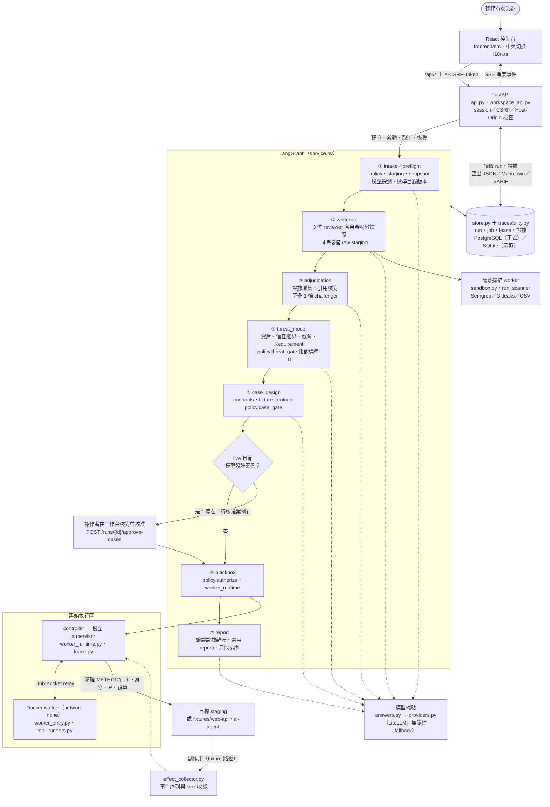
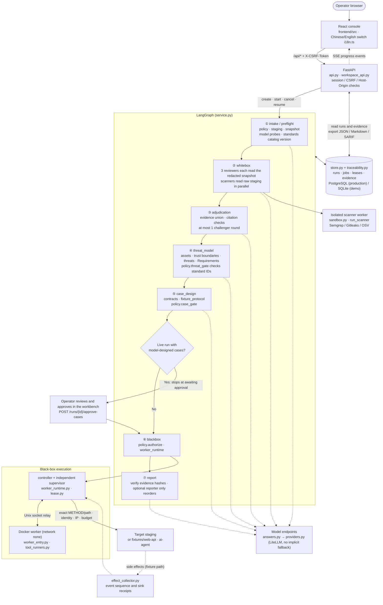

# Vibe Audit 0.2.1

Multi-Agent 資安測試工具包：**白箱獨立審查 → 威脅建模 → 案例與 Oracle → 隔離黑箱 → 證據裁決**。

AI Commander 負責派工；程式 Harness 強制範圍、階段、權限、預算與證據。三個 reviewer 可分別指定 Claude、OpenAI、Nemotron 或本地端點；沒有靜默 fallback：只有操作者明確設定的備援模型，會在指定 Agent 拒答或輸出被截斷時代答，並記在報告裡；也不用多數票決定漏洞。

本次依使用者要求先交付工程與本地整合。**沒有實際三模型端點或付費效果實驗；不宣稱減偏、檢出率或成本改善。** 本地測試使用明確標示的合成模型/靶場；真實工具與隔離基礎設施的驗收另列於 [驗證紀錄](docs/VALIDATION.md)。

## 開啟控制台

Windows 需 Python 3.12+ 與 Node 24。第一次安裝會下載固定版本的相依套件：

```powershell
powershell -ExecutionPolicy Bypass -File scripts/setup.ps1
powershell -ExecutionPolicy Bypass -File scripts/start-local.ps1
```

工具需在原始碼目錄執行：catalogs、fixtures 與 UI 建置不在 Python 套件內。要用 `vibe-audit` 指令請在此目錄 `pip install -e .`；複製出去的 wheel 會拒絕啟動。

開啟啟動時終端機印出的網址（`http://127.0.0.1:8000/#token=…`），先選「合成示範」。權杖只用來建立 session，同一分頁重新整理不需再帶，新分頁請重新開啟啟動網址；後端重啟會產生新權杖，可用 `VIBEAUDIT_SESSION_TOKEN`（32–256 個 URL-safe 字元）固定。控制台可保存專案/模型設定、檢視三份審查、威脅/需求/案例追溯、證據與用量，匯出 JSON/Markdown/SARIF，建立保留原始關聯的修補複測。右上角的「English／中文」按鈕可切換介面語言，選擇會記在這個瀏覽器。

Windows 原生不執行 live 隔離掃描。真實工作流請在 Linux 或 WSL2 依 [Linux 操作指南](docs/LINUX_SETUP.md) 啟動，使用 PostgreSQL、Docker、已準備的模型端點與使用者提供的隔離 staging。

## 能力與邊界

| 層次 | 交付 |
|---|---|
| 指揮核心 | FastAPI + LangGraph、PostgreSQL job ledger、獨立 supervisor/lease、恢復與停止（恢復依已存的 run 紀錄重新檢查閘門，跳過已完成的階段與執行；不從 LangGraph checkpoint 還原） |
| 白箱 | 同範圍三模型隔離初審、證據聯集、一輪 Challenger、來源引用驗證、Semgrep/Gitleaks/OSV |
| 威脅模型 | 自有 JSON、資產/資料流/信任邊界/Requirement、版本與來源、462 個 canonical 標準 IDs |
| Web 黑箱 | 受控 HTTP、ZAP requestor/passive、Schemathesis explicit examples、Playwright API、登入/登出 fixture |
| AI 黑箱 | promptfoo 本地 eval、PyRIT target、reset/cleanup protocol、五次試驗、獨立工具事件與 sink 收據 |
| 結果 | 證據雜湊/歸屬驗證、狀態分級、缺口、追溯工作台、關聯複測、三種匯出 |
| 比較評估 | 七組公平預算 runner、合成 plumbing 與本地 AST 基線、人工 ground-truth 格式；沒有真模型效果結論 |

工具整合使用有界、固定案例。此版沒有任意站點探索、全站主動 fuzz、任意瀏覽器腳本、任意 shell、自動修補/部署、多人 SaaS 或法證級不可竄改儲存。查看 [完整交付對照](docs/DELIVERY.md)。

## 系統架構與流程 (Architecture Overview)

下圖依程式實際行為繪製。操作者透過本機控制台呼叫 FastAPI；每個評估都在 `service.py` 的 LangGraph 圖中依序走過七個階段，每個階段結束時由程式閘門判定能否繼續。各階段經 `stage_answers.py` 決定角色由誰回答、答案留不留，模型回答只經 `answers.py` 取得，由它經 `providers.py` 送出；黑箱請求只能經獨立 supervisor 送往目標；run、job、lease 與證據都寫入 `store.py`。實線是控制與資料流程，虛線是模型呼叫、事件回報與副作用觀測。控制／資料平面與信任邊界見 [docs/ARCHITECTURE.md](docs/ARCHITECTURE.md)，API 與模組契約見 [IMPLEMENTATION.md](IMPLEMENTATION.md)。



| 階段 | 主要模組 | 做什麼、靠什麼把關 |
|---|---|---|
| ① intake／preflight | `api.py`、`policy.py`、`staging.py`、`snapshot.py`、`answers.py`、`catalog.py` | 建立不可變 manifest；複製 raw 私密 staging 並產生脫敏快照；探測模型端點；記錄標準目錄版本；檢查憑證綁定與目標 IP |
| ② whitebox | `stage_answers.py`、`answers.py`、`snapshot.py`、`sandbox.py`、`worker_runtime.py` | 3 位 reviewer 並行審同一份脫敏快照並各自封存；Semgrep／Gitleaks／OSV 同時在隔離 worker 掃描 raw staging；`policy.whitebox_gate` |
| ③ adjudication | `service.py`、`stage_answers.py`、`answers.py` | 保留所有主張的聯集、核對原始碼引用、至多 1 輪 challenger；不以多數票決定 |
| ④ threat_model | `service.py`、`stage_answers.py`、`answers.py`、`policy.py`、`catalog.py` | 建立資產、信任邊界、資料流、威脅與 Requirement；`policy.threat_gate` 比對標準 ID 與版本 |
| ⑤ case_design | `stage_answers.py`、`answers.py`、`contracts.py`、`adapters.py`、`fixture_protocol.py`、`policy.py` | 操作者自填或模型設計的固定案例；header 名稱正規化；`policy.case_gate` 檢查追溯、oracle、範圍與身分 |
| 核准 | `api.py`（approve-cases） | live 且有模型設計案例時停在「待核准案例」；操作者核准這組封存案例後才送出第一個請求 |
| ⑥ blackbox | `policy.py`、`worker_runtime.py`、`lease.py`、`worker_entry.py`、`tool_runners.py`、`adapters.py`、`fixture_protocol.py`、`effect_collector.py` | 每個請求都經 supervisor 檢查 lease、方法／路徑、身分、IP 與預算才送往目標；結果分為 pass／fail／inconclusive／blocked／execution_error／outcome_unknown |
| ⑦ report | `service.py`、`stage_answers.py`、`answers.py`、`store.py`、`traceability.py` | 驗證證據雜湊；選用 reporter 只能重新排序既有發現；API 匯出 JSON、Markdown（中／英）與 SARIF |

### 整體目錄結構

```text
MultiAgentBeta/
├── backend/vibe_audit/            # Python 套件（pip install -e . 後提供 vibe-audit 指令）
│   ├── __main__.py                #   啟動 uvicorn（只聽 127.0.0.1）並印出含權杖的網址
│   ├── api.py                     #   FastAPI：session／CSRF／Host-Origin、runs、approve-cases、SSE、證據、報告、靜態介面
│   ├── workspace_api.py           #   專案、模型範本、標準目錄、追溯、複測、裁決、清理確認
│   ├── service.py                 #   LangGraph 七個階段、閘門呼叫、Markdown／SARIF 報告
│   ├── answers.py                 #   一次付費的模型回答：保留額度、計量、驗證與重試、備援代答、模型探測
│   ├── stage_answers.py           #   階段答案：每個角色由誰回答，答案通過階段檢查才保留、續跑沿用
│   ├── providers.py               #   送出一次的 LiteLLM port、憑證 origin 綁定、無隱性 fallback
│   ├── messages.py                #   錯誤訊息的正體中文對照（API 的 detail_zh、run 的 error_zh）
│   ├── diagnostics.py             #   本機診斷記錄：被固定文字取代的失敗只記例外類型與位置（vibe-audit.log）
│   ├── settings.py                #   後端程序的 VIBEAUDIT_* 設定：一次讀取並檢查（權杖、資料目錄、資料庫、控制台 origins、來源根目錄、目錄與設定檔路徑）
│   ├── staging.py / snapshot.py   #   raw 私密 staging（給掃描器）與脫敏快照（給模型）
│   ├── sandbox.py                 #   白箱掃描器的路徑檢查、上限與結果解析
│   ├── catalog.py                 #   標準 ID 與來源釘選
│   ├── contracts.py / policy.py   #   案例契約；manifest、白箱、威脅、案例閘門與 authorize
│   ├── domain.py / schemas.py     #   資料模型與 JSON schema
│   ├── adapters.py                #   受控 HTTP 傳輸、IP 釘選、oracle 評估
│   ├── request_rules.py           #   請求規則：送往目標的請求能長什麼樣、能不能送出（header、路徑、身分、scope、來源）
│   ├── fixture_protocol.py        #   reset／setup／cleanup 協定、測試身分
│   ├── effect_collector.py        #   獨立事件序列與 sink 收據
│   ├── worker_runtime.py          #   controller ＋ 獨立 supervisor、run_scanner、run_case
│   ├── worker_entry.py            #   supervisor 與 Docker worker 的進入點、Unix socket relay
│   ├── tool_runners.py            #   黑箱工具固定執行：ZAP／Schemathesis／Playwright／promptfoo／PyRIT
│   ├── lease.py                   #   capability／lease 帳本、續約與撤銷
│   ├── store.py / traceability.py #   PostgreSQL／SQLite 儲存、版本化實體與證據連結
│   ├── resource_manifest.py       #   掃描器資源版本紀錄
│   ├── benchmark.py / benchmark_matching.py  # 獨立的比較評估工具（不在評估流程中）
│   └── tokenizers/                #   離線 tiktoken 詞彙表與授權
├── frontend/                      # React ＋ TypeScript ＋ Vite 控制台
│   ├── src/                       #   App.tsx（外殼）、run-detail.tsx、create-form.tsx、capabilities.tsx（三個畫面）、ui.tsx（共用元件與標籤）、extensions.tsx、api.ts、types.ts、i18n.ts（中英切換）、messages.ts（引擎訊息中文）、樣式
│   ├── tests/                     #   vitest 單元與元件測試（happy-dom 模擬瀏覽器，不需後端）
│   ├── scripts/                   #   contract-smoke、browser-smoke、check-i18n、check-messages
│   └── dist/                      #   已建置的介面，由 FastAPI 同 origin 提供
├── tests/                         # pytest（31 個檔案，含 test_bilingual_docs.py 文件雙語檢查與 test_properties.py 的 Hypothesis 性質測試）
├── catalogs/                      # ASVS 5.0.0、WSTG 4.2、LLM 2026、Agentic 2026 標準 JSON 與 manifest
│   └── sources/                   #   原始標準內容與授權
├── fixtures/                      # 掃描器規則與設定（Semgrep、Gitleaks、OSV）
│   ├── web-api/                   #   TypeScript Web API 合成靶場（BOLA 案例）
│   └── ai-agent/                  #   Python AI agent 合成靶場
├── deploy/                        # postgres.compose.yml
│   ├── worker/                    #   worker 與工具映像 Dockerfile、鎖定檔、runtime.example.json
│   └── scanners/                  #   Gitleaks、OSV 映像
├── benchmarks/                    # 比較評估設計、synthetic-v1、examples/、results-local/、results-synthetic/
├── docs/                          # ARCHITECTURE、LINUX_SETUP、DOCKER_INTEGRATION_TESTING、VALIDATION、DELIVERY、SOURCES、
│                                  #   VIBESEC_ADVISORIES、threat-model.yaml、run-input.schema.json、驗證收據、截圖、history/
├── scripts/                       # setup／start-local、dev-env、verify、contract-smoke、provision-runtime／offline-db、package-release、hash-lock、
│                                  #   redact-receipts、summarize-validation、refresh-catalog、render-sample-report、mutation-test、dependency-drift、reanchor-doc-refs
├── .github/workflows/ci.yml       # backend（Python 3.12／3.13／3.14：ruff、mypy、pytest ＋ PostgreSQL、契約 smoke）、frontend（typecheck、ESLint、vitest、check:i18n、check:messages、建置一致性、清單）、文件行號參照（pull request）與 Windows 全套測試
├── .github/workflows/integration.yml  # 以 deploy/ 建置的映像跑 Docker worker、掃描器、工具、fixture 與完整 pipeline 整合測試
├── .github/workflows/mutation.yml     # mutmut 突變測試：閘門與解析模組的每個突變都要被測試抓到（scripts/mutation-test.py）
├── .github/workflows/mutation-pr.yml  # pull request 只對改動的函式做突變測試（scripts/mutation-test.py --changed）
├── .github/workflows/dependency-drift.yml  # 每週列出落後登錄站的固定版本與 OSV 公告（scripts/dependency-drift.py）
├── .claude/                       # SessionStart hook：本機與雲端 session 開始時建好 .venv（不進發佈檔）
├── CLAUDE.md                      # 開發指引（不進發佈檔）
├── IMPLEMENTATION.md              # API 與模組契約
├── GLOSSARY.md                    # 專案用語（模型回答、階段答案、保留額度、代答）
├── CODING_STANDARDS.md            # 程式碼審查時的判斷題（工具抓不到的部分）
├── README.md · LICENSE · NOTICE
├── pyproject.toml · requirements.lock.txt · requirements.mutation.lock.txt   # 固定版本並檢查雜湊的相依套件；第二份只供突變測試
└── source-manifest.sha256         # 每個被追蹤檔案的雜湊清單（scripts/package-release.py）
```

## 安全政策

- 沒有完整三模型初審、有效威脅模型、追溯 Requirement 和 Oracle，黑箱不能取得權限。
- 原始碼只掛載到白箱 worker；黑箱使用不同 UID，無 Docker socket、主機機密或原始碼，容器網路為 none。
- 所有目標請求經獨立 broker；精確 METHOD/path、IP、身分、案例 hash、lease、預算和可選部署 header 每次檢查。redirect 拒絕。
- 憑證只能以 VIBEAUDIT_* 環境變數名稱引用，且不能是本工具自己的設定（資料庫 URL、啟動權杖等）或其別名；目標憑證由 supervisor 注入，不交給工具。local_only 僅接受明確 loopback 模型端點。模型金鑰只會送到操作者以 VIBEAUDIT_MODEL_CREDENTIAL_ORIGINS（`名稱=origin`，逗號分隔）綁定的 origin，請求本文無法改變；VIBEAUDIT_OPENAI_API_KEY 與 VIBEAUDIT_ANTHROPIC_API_KEY 預設綁定官方端點。同一個變數或值不能同時當模型金鑰與測試身分憑證；凡是 VIBEAUDIT_MODEL_CREDENTIAL_ORIGINS 綁定（含預設綁定）的模型金鑰，即使本次執行的模型沒用到，也不能當測試身分憑證。測試身分的憑證同樣只送往以 VIBEAUDIT_TARGET_CREDENTIAL_ORIGINS（`名稱=origin`，逗號分隔，同一名稱可列多個 origin）綁定的目標 origin，預設不綁定；live run 用到未綁定的測試身分時預檢即拒絕，supervisor 送出前也再核對一次。
- 模型設計的案例只能使用操作者標記 model_selectable 的測試身分，header 值只能取固定詞彙中的單一值，不得列多項或帶 q 參數（例如 If-Match 只能是 `*`），而且只能用操作者在該端點允許請求行末 JSON 列出的值（API 為 `allowed_requests[].model_headers`，例如 `GET /api {"Accept":["application/json"]}`），沒列的端點不能帶 header；名稱只有一種拼法、依名稱排序送出，大小寫不同的重複名稱會被拒絕；supervisor 送出前再以同一套詞彙重驗。fixture 路徑上模型撰寫的本文只送到操作者在允許的請求行末標 `model-body`（API 為 `"model_body": true`）的端點。live run 有模型設計的案例時，會先停在「待核准案例」，操作者在工作台核對方法、路徑、標頭、本文與身分並核准這組封存案例後，才送出第一個請求。操作者自填的案例不受這些限制。目標 IP 不能是雲端 metadata、link-local、unspecified 或 multicast 位址，預檢也拒絕會連到本控制台或其資料庫的目標。
- 白箱 raw staging 與模型用脫敏快照分開。staging 副本含有機密檔案，每次執行結束（含 blocked、failed、取消）與服務啟動時都會刪除；恢復時重新複製並必須與凍結時完全相同。來源讀取有上限，脫敏及路由抽取是啟發式；操作者可以列出確切的合成測試憑證（`unredacted_literals`），完全相同的值才不脫敏、會原樣送給模型，報告記下未脫敏的數量，與模型金鑰相同時預檢拒絕；略過的目錄（build、dist、node_modules、.git、symlink）、未讀檔案和未知業務規則會保留缺口。
- 文字宣稱、HTTP 狀態碼、scanner exit 0、模型共識都不能單獨證明安全。控制或觀測失敗不能判為通過。
- 送出後中斷標示 outcome_unknown，不自動重播。停止先撤銷網路；未確認清理仍顯示未完成。
- loopback 單使用者 session：建立 session 需要啟動權杖（同機其他處理程序無法自行取得 session 再探測模型或讀取證據）。cookie 不分 port，所以每個 API 請求（含讀取）都另需只存在該分頁 sessionStorage 的 CSRF token；瀏覽器開過的其他本機服務拿到 cookie 也無法使用。另有 Host/Origin 防護，每個 /api 路由也各自檢查 session 與 CSRF，不只靠 middleware。同時最多 8 個 session，閒置 1 小時或滿 8 小時失效，可在工作台登出；API 可一次結束全部 session，此時自動產生的啟動權杖也會換新並重新印出。錯誤的啟動權杖會讓下一次錯誤回應逐次變慢（上限 5 秒），正確的權杖不受影響。自訂的 VIBEAUDIT_SESSION_TOKEN 必須夠隨機（例如 `python -c "import secrets; print(secrets.token_urlsafe(32))"`），重複字元或重複樣式會被拒絕。資料目錄（VIBEAUDIT_DATA_DIR）在 Linux 上只限擁有者存取（0700），無法設定時服務不啟動；API 與報告以固定文字描述的失敗，其例外類型與程式位置（不含訊息與值）寫在資料目錄的 vibe-audit.log（0600），只留在這台機器；Windows 只執行合成資料的 demo，目錄權限沿用上層目錄的 ACL。受測文字以不可信資料呈現。不要將控制台直接公開到網際網路。

容器、資料庫與控制處理程序的管理者屬信任邊界；本工具無法限制外部 staging 的全部出網，也不能保證找出所有漏洞。

## 文件與開發

- [部署與設定](docs/LINUX_SETUP.md)
- [Docker 整合測試](docs/DOCKER_INTEGRATION_TESTING.md)／[Worker 映像](deploy/worker/README.md)
- [前端建置與連線行為](frontend/README.md)
- [架構與方法](docs/ARCHITECTURE.md)
- [API 與模組契約](IMPLEMENTATION.md)／[用語](GLOSSARY.md)／[程式碼審查規範](CODING_STANDARDS.md)
- [交付對照](docs/DELIVERY.md)／[驗證紀錄](docs/VALIDATION.md)
- [模型減偏比較設計](benchmarks/README.md)
- [來源與授權](docs/SOURCES.md)／[NOTICE](NOTICE)
- [合成範例報告（中英雙語）](docs/sample-report.md)

```powershell
$env:PYTHONPATH = 'backend'
.venv/Scripts/python.exe -m pytest tests -q
cd frontend
npm.cmd run build
```

沒有 Linux/PostgreSQL/固定映像的測試環境，對應整合測試會明確 skip。不能將 skipped 當作驗證通過。

突變測試（Linux，離線）：`python -m pip install --require-hashes -r requirements.mutation.lock.txt` 後執行 `python scripts/mutation-test.py`。mutmut 會逐一改壞 `policy.py`、`adapters.py`、`catalog.py`、`lease.py`、`snapshot.py` 與 `messages.py` 的運算子、常數與分支，再跑涵蓋該函式的單元測試（端對端測試套件因執行時間不在其中，仍由 ci.yml 執行）；測試仍通過或沒有測試涵蓋的改動就是盲點，腳本會列出，而任一模組的數量超過 `tests/mutation-baseline.json` 記錄的上限就以非零結束。`tests/test_properties.py` 以 Hypothesis 對純函式（redaction、origin 解析、雜湊、IP 判定、訊息對照、路由擷取、header 檢查）產生輸入驗證性質，同樣離線。lease 測試在 SQLite 與 PostgreSQL 各跑一次（設定 `VIBEAUDIT_TEST_DATABASE_URL` 時；每個測試用自己的資料庫），所以只在 PostgreSQL 上才有差別的鎖定與時鐘改動也抓得到。`.github/workflows/mutation.yml` 每週執行同一件事；pull request 則由 `.github/workflows/mutation-pr.yml` 執行 `python scripts/mutation-test.py --changed origin/main`，只改壞 diff 碰到的函式，每個函式的逃脫數不得超過基準為它記錄的數字（新函式不得有逃脫），幾分鐘內就有結果。這兩個 workflow 預設關閉：只有 repository variable `VIBEAUDIT_MUTATION` 設為 `true` 時才會自動執行，手動 dispatch 則一律執行。相依套件漂移（需要網路）：`python scripts/dependency-drift.py` 讀兩份 Python 鎖定檔與 `frontend/package-lock.json`，向 PyPI、npm registry 查最新版本、向 OSV 查固定版本的安全公告，印出 Markdown 報告（`--all` 列出全部、`--json` 輸出資料）；有公告才以非零結束，不會自動升級。`.github/workflows/dependency-drift.yml` 每週把報告寫進 job summary。核心 Apache-2.0；外部工具、規則、模型與標準內容各保留原授權。

---
# Vibe Audit 0.2.1

Multi-Agent security testing toolkit: **white-box independent review → threat modeling → cases and Oracles → isolated black-box → evidence adjudication**.

The AI Commander dispatches work; the programmatic Harness enforces scope, phases, permissions, budgets, and evidence. The three reviewers can each be pointed at Claude, OpenAI, Nemotron, or a local endpoint; there is no silent fallback: only a fallback model the operator configures answers, when a named agent refuses or is truncated, and the report records it; vulnerabilities are not decided by majority vote.

At the user's request, this release delivers engineering and local integration first. **There are no real three-model endpoints or paid-effect experiments; no claims of bias reduction, detection-rate improvement, or cost improvement are made.** Local testing uses clearly labeled synthetic models/ranges; acceptance for real tools and isolated infrastructure is listed separately in the [validation log](docs/VALIDATION.md).

## Opening the Console

Windows needs Python 3.12+ and Node 24. The first installation downloads pinned dependencies:

```powershell
powershell -ExecutionPolicy Bypass -File scripts/setup.ps1
powershell -ExecutionPolicy Bypass -File scripts/start-local.ps1
```

The tool must be run from the source directory: catalogs, fixtures, and the UI build are not inside the Python package. To use the `vibe-audit` command, run `pip install -e .` in this directory; a wheel copied elsewhere will refuse to start.

Open the URL printed by the launcher terminal (`http://127.0.0.1:8000/#token=…`) and first pick 「合成示範」 (Synthetic demo in the English interface). The token is only used to establish a session; refreshing the same tab does not need to carry it again, and a new tab should reopen the launcher URL; a backend restart mints a new token, which can be pinned with `VIBEAUDIT_SESSION_TOKEN` (32–256 URL-safe characters). The console can save project/model settings, view the three reviews, threat/requirement/case traceability, evidence and usage, export JSON/Markdown/SARIF, and create remediation retests that preserve the original associations. The English／中文 button at the top right switches the interface language; the browser remembers the choice.

Windows natively does not run live isolated scans. For the real workflow, start on Linux or WSL2 following the [Linux setup guide](docs/LINUX_SETUP.md), using PostgreSQL, Docker, prepared model endpoints, and user-provided isolated staging.

## Capabilities and Boundaries

| Layer | Deliverable |
|---|---|
| Command core | FastAPI + LangGraph, PostgreSQL job ledger, independent supervisor/lease, resume and stop (resume re-checks the gates against stored run records, skipping completed phases and executions; does not restore from LangGraph checkpoints) |
| White-box | Same-scope three-model isolated initial review, evidence union, one Challenger round, source-citation verification, Semgrep/Gitleaks/OSV |
| Threat model | Its own JSON, assets/data flows/trust boundaries/Requirement, versions and sources, 462 canonical standard IDs |
| Web black-box | Controlled HTTP, ZAP requestor/passive, Schemathesis explicit examples, Playwright API, login/logout fixture |
| AI black-box | promptfoo local eval, PyRIT target, reset/cleanup protocol, five trials, independent tool events and sink receipts |
| Results | Evidence hash/attribution verification, status grading, gaps, traceability workbench, associated retests, three export formats |
| Comparative evaluation | Seven groups of fair-budget runners, synthetic plumbing and a local AST baseline, human ground-truth format; no real-model effectiveness conclusions |

Tool integrations use bounded, fixed cases. This version has no arbitrary site exploration, site-wide active fuzzing, arbitrary browser scripting, arbitrary shell, automatic patching/deployment, multi-tenant SaaS, or forensics-grade tamper-proof storage. See the [full delivery comparison](docs/DELIVERY.md).

## Architecture Overview

The diagram follows what the code actually does. The operator calls FastAPI from the local console; every assessment walks the seven stages of the LangGraph graph in `service.py` in order, and a code gate decides at the end of each stage whether it may continue. Stages go through `stage_answers.py`, which decides who answers a role and whether the answer is kept; model answers come only through `answers.py`, which sends through `providers.py`; black-box requests reach the target only through the independent supervisor; runs, jobs, leases and evidence are written to `store.py`. Solid lines are control and data flow; dashed lines are model calls, event reporting and side-effect observation. Control/data planes and trust boundaries are in [docs/ARCHITECTURE.md](docs/ARCHITECTURE.md); API and module contracts are in [IMPLEMENTATION.md](IMPLEMENTATION.md).



| Stage | Main modules | What it does and what gates it |
|---|---|---|
| ① intake / preflight | `api.py`, `policy.py`, `staging.py`, `snapshot.py`, `answers.py`, `catalog.py` | Creates the immutable manifest; copies the raw private staging and builds the redacted snapshot; probes model endpoints; records the standards catalog version; checks credential bindings and target IPs |
| ② whitebox | `stage_answers.py`, `answers.py`, `snapshot.py`, `sandbox.py`, `worker_runtime.py` | 3 reviewers read the same redacted snapshot in parallel and each review is sealed; Semgrep / Gitleaks / OSV scan the raw staging in isolated workers at the same time; `policy.whitebox_gate` |
| ③ adjudication | `service.py`, `stage_answers.py`, `answers.py` | Keeps the union of all claims, checks source citations, at most 1 challenger round; no majority vote |
| ④ threat_model | `service.py`, `stage_answers.py`, `answers.py`, `policy.py`, `catalog.py` | Builds assets, trust boundaries, data flows, threats and Requirements; `policy.threat_gate` checks standard IDs and versions |
| ⑤ case_design | `stage_answers.py`, `answers.py`, `contracts.py`, `adapters.py`, `fixture_protocol.py`, `policy.py` | Fixed cases written by the operator or designed by a model; header names are canonicalized; `policy.case_gate` checks traceability, oracles, scope and identities |
| Approval | `api.py` (approve-cases) | A live run with model-designed cases stops at awaiting approval; the first request goes out only after the operator approves that sealed set |
| ⑥ blackbox | `policy.py`, `worker_runtime.py`, `lease.py`, `worker_entry.py`, `tool_runners.py`, `adapters.py`, `fixture_protocol.py`, `effect_collector.py` | Every request is checked by the supervisor for lease, method/path, identity, IP and budget before it reaches the target; results are pass / fail / inconclusive / blocked / execution_error / outcome_unknown |
| ⑦ report | `service.py`, `stage_answers.py`, `answers.py`, `store.py`, `traceability.py` | Verifies evidence hashes; an optional reporter can only reorder existing findings; the API exports JSON, Markdown (Chinese or English) and SARIF |

### Repository Layout

```text
MultiAgentBeta/
├── backend/vibe_audit/            # Python package (pip install -e . provides the vibe-audit command)
│   ├── __main__.py                #   starts uvicorn (127.0.0.1 only) and prints the URL with the token
│   ├── api.py                     #   FastAPI: session/CSRF/Host-Origin, runs, approve-cases, SSE, evidence, reports, static UI
│   ├── workspace_api.py           #   projects, model templates, standards catalog, trace, retest, decisions, cleanup attestation
│   ├── service.py                 #   the seven LangGraph stages, gate calls, Markdown/SARIF reports
│   ├── answers.py                 #   One paid model answer: reservation, metering, validation and retry, fallback answers, model probes
│   ├── stage_answers.py           #   Stage answers: who answers each role, kept only after the stage's checks pass and reused on resume
│   ├── providers.py               #   The send-once LiteLLM port, credential origin binding, no implicit fallback
│   ├── messages.py                #   Traditional Chinese wording of error messages (detail_zh, error_zh)
│   ├── diagnostics.py             #   local diagnostics: failures reported in fixed words log their type and location (vibe-audit.log)
│   ├── settings.py                #   the backend process's VIBEAUDIT_* settings, read and checked once (token, data dir, database, console origins, source roots, catalog and config paths)
│   ├── staging.py / snapshot.py   #   raw private staging (for scanners) and redacted snapshot (for models)
│   ├── sandbox.py                 #   white-box scanner path checks, bounds and result parsing
│   ├── catalog.py                 #   standard IDs and source pins
│   ├── contracts.py / policy.py   #   case contract; manifest, white-box, threat and case gates, authorize
│   ├── domain.py / schemas.py     #   data model and JSON schemas
│   ├── adapters.py                #   controlled HTTP transport, IP pinning, oracle evaluation
│   ├── request_rules.py           #   request rules: what a request to the target may look like and whether it may be sent (headers, path, identity, scope, provenance)
│   ├── fixture_protocol.py        #   reset/setup/cleanup protocol, test identities
│   ├── effect_collector.py        #   independent event sequence and sink receipts
│   ├── worker_runtime.py          #   controller + independent supervisor, run_scanner, run_case
│   ├── worker_entry.py            #   supervisor and Docker worker entry points, Unix socket relay
│   ├── tool_runners.py            #   fixed black-box tool runs: ZAP/Schemathesis/Playwright/promptfoo/PyRIT
│   ├── lease.py                   #   capability/lease ledger, renewal and revocation
│   ├── store.py / traceability.py #   PostgreSQL/SQLite storage, versioned entities and evidence links
│   ├── resource_manifest.py       #   scanner resource version records
│   ├── benchmark.py / benchmark_matching.py  # separate comparative-evaluation tool (not part of an assessment)
│   └── tokenizers/                #   offline tiktoken vocabulary and license
├── frontend/                      # React + TypeScript + Vite console
│   ├── src/                       #   App.tsx (shell), run-detail.tsx, create-form.tsx, capabilities.tsx (the three screens), ui.tsx (shared pieces and labels), extensions.tsx, api.ts, types.ts, i18n.ts (language switch), messages.ts (engine messages in Chinese), styles
│   ├── tests/                     #   vitest unit and component tests (happy-dom simulated browser, no backend)
│   ├── scripts/                   #   contract-smoke, browser-smoke, check-i18n, check-messages
│   └── dist/                      #   built UI, served by FastAPI on the same origin
├── tests/                         # pytest (31 files, including test_bilingual_docs.py for bilingual docs and the Hypothesis property tests in test_properties.py)
├── catalogs/                      # ASVS 5.0.0, WSTG 4.2, LLM 2026, Agentic 2026 standard JSON and manifest
│   └── sources/                   #   original standard content and licenses
├── fixtures/                      # scanner rules and settings (Semgrep, Gitleaks, OSV)
│   ├── web-api/                   #   TypeScript Web API synthetic target (BOLA case)
│   └── ai-agent/                  #   Python AI agent synthetic target
├── deploy/                        # postgres.compose.yml
│   ├── worker/                    #   worker and tool image Dockerfiles, locks, runtime.example.json
│   └── scanners/                  #   Gitleaks and OSV images
├── benchmarks/                    # comparison design, synthetic-v1, examples/, results-local/, results-synthetic/
├── docs/                          # ARCHITECTURE, LINUX_SETUP, DOCKER_INTEGRATION_TESTING, VALIDATION, DELIVERY, SOURCES,
│                                  #   VIBESEC_ADVISORIES, threat-model.yaml, run-input.schema.json, receipts, screenshots, history/
├── scripts/                       # setup/start-local, dev-env, verify, contract-smoke, provision-runtime/offline-db, package-release, hash-lock,
│                                  #   redact-receipts, summarize-validation, refresh-catalog, render-sample-report, mutation-test, dependency-drift, reanchor-doc-refs
├── .github/workflows/ci.yml       # backend (Python 3.12/3.13/3.14: ruff, mypy, pytest + PostgreSQL, contract smoke), frontend (typecheck, ESLint, vitest, check:i18n, check:messages, build parity, manifest), doc line references (pull requests) and the full test suite on Windows
├── .github/workflows/integration.yml  # Docker worker, scanner, tool, fixture and full-pipeline integration tests on images built from deploy/
├── .github/workflows/mutation.yml     # mutmut mutation testing: every mutant of the gate and parser modules must be caught (scripts/mutation-test.py)
├── .github/workflows/mutation-pr.yml  # a pull request mutates only the functions it changed (scripts/mutation-test.py --changed)
├── .github/workflows/dependency-drift.yml  # weekly: pins behind their registries and OSV advisories (scripts/dependency-drift.py)
├── .claude/                       # SessionStart hook: builds .venv when a local or cloud session starts (excluded from releases)
├── CLAUDE.md                      # development guide (excluded from releases)
├── IMPLEMENTATION.md              # API and module contracts
├── GLOSSARY.md                    # Project terms (model answer, stage answer, reservation, fallback answer)
├── CODING_STANDARDS.md            # judgement calls for code review (what no tool catches)
├── README.md · LICENSE · NOTICE
├── pyproject.toml · requirements.lock.txt · requirements.mutation.lock.txt   # pinned, hash-checked dependencies; the second only for mutation testing
└── source-manifest.sha256         # hash list of every tracked file (scripts/package-release.py)
```

## Security Policy

- Without a complete three-model initial review, a valid threat model, traceable Requirements, and Oracles, the black-box cannot obtain permissions.
- Source code is mounted only into white-box workers; the black-box runs under a different UID with no Docker socket, host secrets, or source code, and the container network is none.
- All target requests go through an independent broker; exact METHOD/path, IP, identity, case hash, lease, budget, and optional deployment headers are checked every time. Redirects are refused.
- Credentials may only be referenced by VIBEAUDIT_* environment variable names, and cannot be this tool's own settings (database URL, launcher token, etc.) or aliases of them; target credentials are injected by the supervisor and are not handed to the tools. local_only accepts only explicitly loopback model endpoints. A model key is sent only to the origins the operator binds it to in VIBEAUDIT_MODEL_CREDENTIAL_ORIGINS (comma-separated `NAME=origin` entries); a request cannot change that. VIBEAUDIT_OPENAI_API_KEY and VIBEAUDIT_ANTHROPIC_API_KEY are bound to their vendors' endpoints by default. The same variable or value cannot be both a model key and a test identity credential; a key bound in VIBEAUDIT_MODEL_CREDENTIAL_ORIGINS (or bound by default) cannot be a test identity credential even when the run's models do not use it. A test identity's credential likewise goes only to the target origins it is bound to in VIBEAUDIT_TARGET_CREDENTIAL_ORIGINS (comma-separated `NAME=origin` entries; a name may be listed for several origins), and nothing is bound by default: preflight refuses a live run that uses an unbound test identity, and the supervisor checks the binding again before sending.
- Model-designed cases may use only test identities the operator marks model_selectable, and their header values are single values from fixed vocabularies, with no lists or q parameters (If-Match, for example, can only be `*`), and only the values the operator lists for that endpoint in a JSON object at the end of its allowed-request line (`allowed_requests[].model_headers` in the API, for example `GET /api {"Accept":["application/json"]}`); an endpoint with no list takes no model header; each header name has one spelling and the names are sent in sorted order, a name repeated in another letter case is refused, and the supervisor checks the same vocabulary again before sending. On a fixture path a model-written body goes only to an endpoint the operator marks with `model-body` at the end of its allowed-request line (`"model_body": true` in the API). A live run with model-designed cases first stops at "awaiting approval"; the operator reviews the method, path, headers, body and identity in the workbench and approves that sealed set before the first request is sent. Operator-written cases are not restricted this way. Target IPs cannot be cloud metadata, link-local, unspecified or multicast addresses, and preflight refuses a target that would reach this console or its database.
- White-box raw staging is kept separate from the redacted snapshot used by models. The staging copy contains sensitive files and is deleted at the end of every run (including blocked, failed, and cancelled) and at service startup; on resume it is re-copied and must be exactly identical to the frozen state. Source reads are capped, and redaction and route extraction are heuristic; the operator can list exact synthetic test credentials (`unredacted_literals`), and only an identical value stays unredacted and is sent to the models as written, the report records how many, and preflight refuses one equal to a model key; skipped directories (build, dist, node_modules, .git, symlink), unread files, and unknown business rules remain as gaps.
- Textual claims, HTTP status codes, scanner exit 0, and model consensus cannot alone prove security. Control or observation failures cannot be judged as passes.
- Interruptions after submission are marked outcome_unknown and are not replayed automatically. Stopping revokes network access first; unconfirmed cleanup still shows as incomplete.
- loopback single-user session: establishing a session requires the launcher token (other processes on the same machine cannot obtain a session on their own and then probe models or read evidence). Cookies are not port-scoped, so every API request (including reads) additionally requires a CSRF token that exists only in that tab's sessionStorage; other local services the browser has opened cannot use it even if they obtain the cookie. Host/Origin protections are also in place, and every /api route checks the session and CSRF token itself rather than relying on the middleware alone. At most 8 sessions exist at once; a session ends after 1 hour idle or 8 hours, and the workbench can log out; the API can end every session at once, which also replaces a generated startup token and prints the new one. Each recent wrong startup token slows the next wrong answer (up to 5 seconds); the right token is never held back. A custom VIBEAUDIT_SESSION_TOKEN must be random (for example `python -c "import secrets; print(secrets.token_urlsafe(32))"`); repeated characters or patterns are refused. On Linux the data directory (VIBEAUDIT_DATA_DIR) is owner-only (0700), and the service does not start if it cannot be made so; a failure the API or a report describes in fixed words is explained by its exception type and code location (never its message or values) in vibe-audit.log inside the data directory (0600), which stays on this machine; Windows runs only the synthetic demo, and the directory keeps the ACL it inherits. Tested text is presented as untrusted data. Do not expose the console directly to the internet.

Containers, the database, and control-process administrators are trust boundaries; this tool cannot restrict all outbound traffic from external staging, nor can it guarantee finding all vulnerabilities.

## Documentation and Development

- [Deployment and configuration](docs/LINUX_SETUP.md)
- [Docker integration testing](docs/DOCKER_INTEGRATION_TESTING.md) / [Worker images](deploy/worker/README.md)
- [Frontend build and connection behavior](frontend/README.md)
- [Architecture and methodology](docs/ARCHITECTURE.md)
- [API and module contracts](IMPLEMENTATION.md) / [Glossary](GLOSSARY.md) / [Code review standards](CODING_STANDARDS.md)
- [Delivery comparison](docs/DELIVERY.md) / [Validation log](docs/VALIDATION.md)
- [Bias-reduction comparison design](benchmarks/README.md)
- [Sources and license](docs/SOURCES.md) / [NOTICE](NOTICE)
- [Synthetic sample report (Chinese and English)](docs/sample-report.md)

```powershell
$env:PYTHONPATH = 'backend'
.venv/Scripts/python.exe -m pytest tests -q
cd frontend
npm.cmd run build
```

Without a test environment with Linux/PostgreSQL/pinned images, the corresponding integration tests explicitly skip. Skipped must not be treated as verification passed.

Mutation testing (Linux, offline): `python -m pip install --require-hashes -r requirements.mutation.lock.txt`, then `python scripts/mutation-test.py`. mutmut changes one operator, constant or branch of `policy.py`, `adapters.py`, `catalog.py`, `lease.py`, `snapshot.py` and `messages.py` at a time and runs the unit tests that cover that function (the end-to-end suites are left out for run time; ci.yml still runs them); a change the tests still pass, or that no test reaches, is a blind spot: the script lists them and exits non-zero when any module exceeds the ceiling recorded in `tests/mutation-baseline.json`. `tests/test_properties.py` checks properties of the pure functions (redaction, origin parsing, hashes, IP rules, message table, route extraction, header checks) over inputs Hypothesis generates, offline as well. The lease tests run once on SQLite and once on PostgreSQL (when `VIBEAUDIT_TEST_DATABASE_URL` is set; each test gets its own database), so a lock or clock change that only shows on PostgreSQL is caught too. `.github/workflows/mutation.yml` does the same weekly; on a pull request `.github/workflows/mutation-pr.yml` runs `python scripts/mutation-test.py --changed origin/main`, which mutates only the functions the diff touched and lets none of them exceed the count the baseline records for it (a new function must let none), so the answer arrives in minutes. Both workflows are off by default: they run on their own only when the repository variable `VIBEAUDIT_MUTATION` is `true`; a manual dispatch always runs. Dependency drift (needs the network): `python scripts/dependency-drift.py` reads both Python lock files and `frontend/package-lock.json`, asks PyPI and the npm registry for the latest release and OSV for advisories against the pinned versions, and prints a Markdown report (`--all` lists every pin, `--json` the data); it exits non-zero only for an advisory and upgrades nothing. `.github/workflows/dependency-drift.yml` writes the report to the job summary weekly. The core is Apache-2.0; external tools, rules, models, and standard content retain their original licenses.
