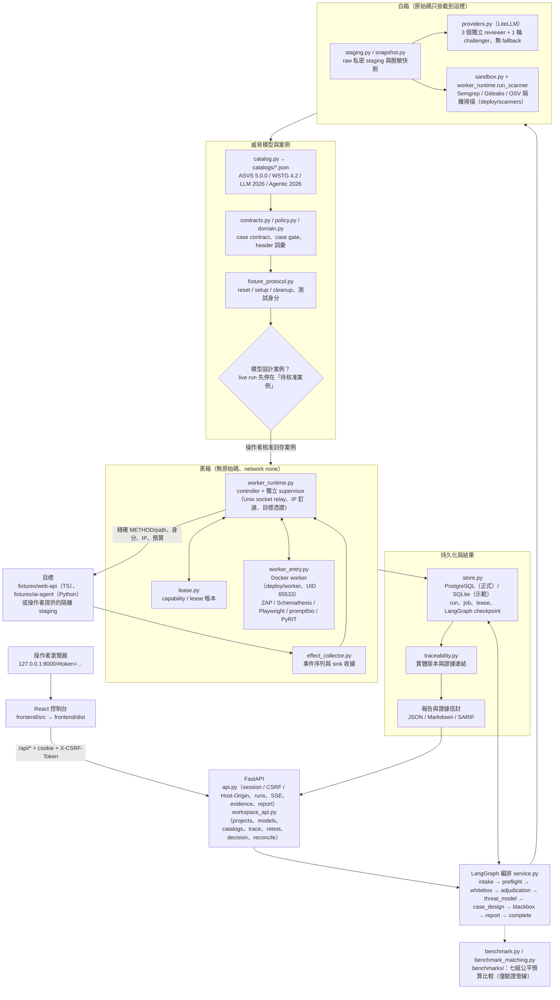
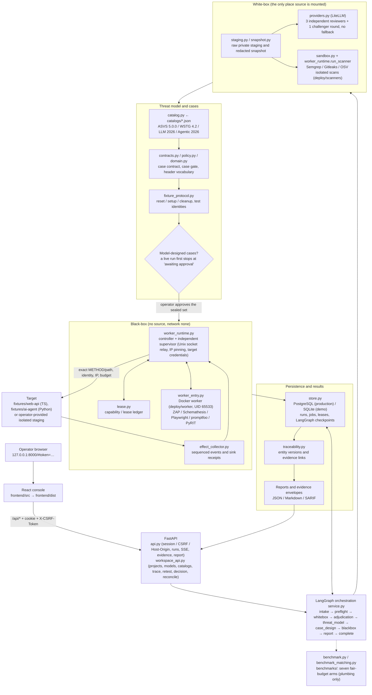

# Vibe Audit 0.2.1

Multi-Agent 資安測試工具包：**白箱獨立審查 → 威脅建模 → 案例與 Oracle → 隔離黑箱 → 證據裁決**。

AI Commander 負責派工；程式 Harness 強制範圍、階段、權限、預算與證據。三個 reviewer 可分別指定 Claude、OpenAI、Nemotron 或本地端點；沒有靜默 fallback，也不用多數票決定漏洞。

本次依使用者要求先交付工程與本地整合。**沒有實際三模型端點或付費效果實驗；不宣稱減偏、檢出率或成本改善。** 本地測試使用明確標示的合成模型/靶場；真實工具與隔離基礎設施的驗收另列於 [驗證紀錄](docs/VALIDATION.md)。

## 開啟控制台

Windows 需 Python 3.12+ 與 Node 24。第一次安裝會下載固定依賴：

```powershell
powershell -ExecutionPolicy Bypass -File scripts/setup.ps1
powershell -ExecutionPolicy Bypass -File scripts/start-local.ps1
```

工具需在原始碼目錄執行：catalogs、fixtures 與 UI 建置不在 Python 套件內。要用 `vibe-audit` 指令請在此目錄 `pip install -e .`；複製出去的 wheel 會拒絕啟動。

開啟啟動時終端機印出的網址（`http://127.0.0.1:8000/#token=…`），先選「合成示範」。權杖只用來建立 session，同一分頁重新整理不需再帶，新分頁請重新開啟啟動網址；後端重啟會產生新權杖，可用 `VIBEAUDIT_SESSION_TOKEN`（32–256 個 URL-safe 字元）固定。控制台可保存專案/模型設定、檢視三份審查、威脅/需求/案例追溯、證據與用量，匯出 JSON/Markdown/SARIF，建立保留原始關聯的修補複測。

Windows 原生不執行 live 隔離掃描。真實工作流請在 Linux 或 WSL2 依 [Linux 操作指南](docs/LINUX_SETUP.md) 啟動，使用 PostgreSQL、Docker、已準備的模型端點與使用者提供的隔離 staging。

## 能力與邊界

| 層次 | 交付 |
|---|---|
| 指揮核心 | FastAPI + LangGraph、PostgreSQL job ledger、獨立 supervisor/lease、恢復與停止（恢復依已存的 run 紀錄重新檢查閘門，跳過已完成的階段與執行；不從 LangGraph checkpoint 還原） |
| 白箱 | 同範圍三模型隔離初審、證據聯集、一輪 Challenger、來源引用驗證、Semgrep/Gitleaks/OSV |
| 威脅模型 | 自有 JSON、資產/資料流/信任邊界/Requirement、版本與來源、462 個 canonical 標準 IDs |
| Web 黑箱 | 受控 HTTP、ZAP requestor/passive、Schemathesis explicit examples、Playwright API、登入/登出 fixture |
| AI 黑箱 | promptfoo 本地 eval、PyRIT target、reset/cleanup protocol、五次試驗、獨立工具事件與 sink 收據 |
| 結果 | 證據雜湊/歸屬驗證、狀態分級、缺口、追溯工作台、關聯複測、三種匯出 |
| 比較評估 | 七組公平預算 runner、合成 plumbing 與本地 AST 基線、人工 ground-truth 格式；沒有真模型效果結論 |

工具整合使用有界、固定案例。此版沒有任意站點探索、全站主動 fuzz、任意瀏覽器腳本、任意 shell、自動修補/部署、多人 SaaS 或法證級不可竄改儲存。查看 [完整交付對照](docs/DELIVERY.md)。

## 系統架構與流程 (Architecture Overview)

操作者在本機瀏覽器開啟 React 控制台，所有操作都經 FastAPI（session／CSRF／Host-Origin 檢查）進入 `service.py` 的 LangGraph 圖；圖依固定順序走過白箱、裁決、威脅模型、案例設計、黑箱與報告，每一階段的閘門由程式判定而不是模型。黑箱請求只能經由獨立 supervisor 與 lease 送往目標，證據與追溯寫入 PostgreSQL（示範為 SQLite）後再回到控制台。控制平面／資料平面與信任邊界見 [docs/ARCHITECTURE.md](docs/ARCHITECTURE.md)，API 與模組契約見 [IMPLEMENTATION.md](IMPLEMENTATION.md)。



| 階段 | 主要模組 | 產出與閘門 |
|---|---|---|
| intake / preflight | `api.py`、`policy.py`、`staging.py`、`resource_manifest.py` | 不可變 manifest、凍結原始碼摘要、模型端點探測、憑證與目標 IP 預檢 |
| whitebox | `snapshot.py`、`providers.py`、`sandbox.py`、`worker_runtime.py` | 三份獨立封存審查、Semgrep/Gitleaks/OSV 證據；reviewer 看不到彼此與掃描器結論 |
| adjudication | `service.py`、`providers.py` | 證據聯集、來源引用驗證、至多一輪 challenger；不以多數票決定 |
| threat_model | `catalog.py`、`contracts.py`、`traceability.py` | 資產／資料流／信任邊界／威脅／Requirement，綁定 canonical 標準 ID 與版本 |
| case_design | `contracts.py`、`policy.py`、`fixture_protocol.py` | 可追溯、含 positive control 與 oracle 的固定案例；模型設計案例需操作者核准 |
| blackbox | `worker_runtime.py`、`lease.py`、`worker_entry.py`、`tool_runners.py`、`effect_collector.py`、`adapters.py` | 經 supervisor 的受控請求、獨立觀測與 sink 收據；pass/fail/inconclusive/blocked/execution_error/outcome_unknown |
| report / complete | `service.py`、`store.py`、`traceability.py` | 雜湊驗證的證據信封、追溯圖、JSON/Markdown/SARIF 匯出、關聯複測 |

### 整體目錄結構

```text
MultiAgentBeta/
├── backend/vibe_audit/            # Python 套件（pip install -e . 後提供 vibe-audit 指令）
│   ├── __main__.py                #   啟動 uvicorn（127.0.0.1）、印出啟動網址
│   ├── api.py                     #   FastAPI：session/CSRF/Host-Origin、/api/runs、SSE、evidence、report、靜態 UI
│   ├── workspace_api.py           #   /api/projects、/models、/catalogs、trace、retest、decision、reconcile
│   ├── service.py                 #   LangGraph 編排、各階段、閘門、Markdown/SARIF 報告
│   ├── providers.py               #   LiteLLM 模型呼叫、憑證 origin 綁定、無 fallback
│   ├── staging.py / snapshot.py   #   raw 私密 staging 與脫敏快照
│   ├── sandbox.py                 #   白箱掃描器（Semgrep/Gitleaks/OSV）路徑、上限與結果解析
│   ├── tool_runners.py            #   黑箱工具固定執行：ZAP/Schemathesis/Playwright/promptfoo/PyRIT
│   ├── catalog.py                 #   canonical 標準 ID 與來源釘選
│   ├── contracts.py / policy.py   #   case contract、閘門、header 詞彙、憑證規則
│   ├── domain.py / schemas.py     #   資料模型與 JSON schema
│   ├── adapters.py                #   受控 HTTP 傳輸、IP 釘選、oracle 評估
│   ├── fixture_protocol.py        #   reset/setup/cleanup 協定、測試身分
│   ├── worker_runtime.py          #   controller + 獨立 supervisor、Unix socket relay
│   ├── worker_entry.py            #   Docker worker 進入點
│   ├── lease.py                   #   capability/lease 帳本、續約與撤銷
│   ├── effect_collector.py        #   獨立事件序列與 sink 收據
│   ├── store.py / traceability.py #   PostgreSQL/SQLite 儲存、版本化實體與證據連結
│   ├── resource_manifest.py       #   資源版本紀錄
│   ├── benchmark.py / benchmark_matching.py  # 比較評估 runner 與結果比對
│   └── tokenizers/                #   離線 tiktoken 詞彙表
├── frontend/                      # React + TypeScript + Vite 控制台
│   ├── src/                       #   App.tsx、api.ts、types.ts、extensions.tsx、main.tsx
│   ├── dist/                      #   已建置的 UI，由 FastAPI 同 origin 提供
│   └── scripts/                   #   browser-smoke、contract-smoke
├── tests/                         # pytest（engine、providers、worker_runtime、lease、sandbox、local_pipeline…）
├── catalogs/                      # ASVS 5.0.0、WSTG 4.2、LLM 2026、Agentic 2026 canonical JSON、manifest、source-lock
│   └── sources/                   #   原始標準內容與授權
├── fixtures/                      # 合成靶場
│   ├── web-api/                   #   TypeScript Web API（BOLA 案例）
│   └── ai-agent/                  #   Python AI agent 目標
├── deploy/                        # postgres.compose.yml
│   ├── worker/                    #   worker Dockerfile、工具映像鎖定、runtime.example.json
│   └── scanners/                  #   Gitleaks、OSV 映像
├── benchmarks/                    # 比較評估設計、synthetic-v1、examples/、results-local/、results-synthetic/
├── docs/                          # ARCHITECTURE、LINUX_SETUP、DELIVERY、VALIDATION、SOURCES、schema、驗證紀錄（XML/JSON）、history/
├── scripts/                       # setup/start-local、verify、provision-runtime/offline-db、package-release、hash-lock、refresh-catalog
├── .github/workflows/ci.yml       # backend（pytest + PostgreSQL）與 frontend（typecheck）
├── IMPLEMENTATION.md              # API 與模組契約
├── README.md · LICENSE · NOTICE
├── pyproject.toml · requirements.lock.txt   # 固定依賴（hash 檢查）
└── source-manifest.sha256         # 來源檔案雜湊清單（scripts/package-release.py）
```

## 安全政策

- 沒有完整三模型初審、有效威脅模型、追溯 Requirement 和 Oracle，黑箱不能取得權限。
- 原始碼只掛載到白箱 worker；黑箱使用不同 UID，無 Docker socket、主機機密或原始碼，容器網路為 none。
- 所有目標請求經獨立 broker；精確 METHOD/path、IP、身分、案例 hash、lease、預算和可選部署 header 每次檢查。redirect 拒絕。
- 憑證只能以 VIBEAUDIT_* 環境變數名稱引用，且不能是本工具自己的設定（資料庫 URL、啟動權杖等）或其別名；目標憑證由 supervisor 注入，不交給工具。local_only 僅接受明確 loopback 模型端點。模型金鑰只會送到操作者以 VIBEAUDIT_MODEL_CREDENTIAL_ORIGINS（`名稱=origin`，逗號分隔）綁定的 origin，請求本文無法改變；VIBEAUDIT_OPENAI_API_KEY 與 VIBEAUDIT_ANTHROPIC_API_KEY 預設綁定官方端點。同一個變數或值不能同時當模型金鑰與測試身分憑證；凡是 VIBEAUDIT_MODEL_CREDENTIAL_ORIGINS 綁定（含預設綁定）的模型金鑰，即使本次執行的模型沒用到，也不能當測試身分憑證。測試身分的憑證同樣只送往以 VIBEAUDIT_TARGET_CREDENTIAL_ORIGINS（`名稱=origin`，逗號分隔，同一名稱可列多個 origin）綁定的目標 origin，預設不綁定；live run 用到未綁定的測試身分時預檢即拒絕，supervisor 送出前也再核對一次。
- 模型設計的案例只能使用操作者標記 model_selectable 的測試身分，header 值只能取固定詞彙中的單一值，不得列多項或帶 q 參數（例如 If-Match 只能是 `*`），而且只能用操作者在該端點允許請求行末 JSON 列出的值（API 為 `allowed_requests[].model_headers`，例如 `GET /api {"Accept":["application/json"]}`），沒列的端點不能帶 header；名稱只有一種拼法、依名稱排序送出，大小寫不同的重複名稱會被拒絕；supervisor 送出前再以同一套詞彙重驗。fixture 路徑上模型撰寫的本文只送到操作者在允許的請求行末標 `model-body`（API 為 `"model_body": true`）的端點。live run 有模型設計的案例時，會先停在「待核准案例」，操作者在工作台核對方法、路徑、標頭、本文與身分並核准這組封存案例後，才送出第一個請求。操作者自填的案例不受這些限制。目標 IP 不能是雲端 metadata、link-local、unspecified 或 multicast 位址，預檢也拒絕會連到本控制台或其資料庫的目標。
- 白箱 raw staging 與模型用脫敏快照分開。staging 副本含有機密檔案，每次執行結束（含 blocked、failed、取消）與服務啟動時都會刪除；恢復時重新複製並必須與凍結時完全相同。來源讀取有上限，脫敏及路由抽取是啟發式；略過的目錄（build、dist、node_modules、.git、symlink）、未讀檔案和未知業務規則會保留缺口。
- 文字宣稱、HTTP 狀態碼、scanner exit 0、模型共識都不能單獨證明安全。控制或觀測失敗不能判為通過。
- 送出後中斷標示 outcome_unknown，不自動重播。停止先撤銷網路；未確認清理仍顯示未完成。
- loopback 單使用者 session：建立 session 需要啟動權杖（同機其他程序無法自行取得 session 再探測模型或讀取證據）。cookie 不分 port，所以每個 API 請求（含讀取）都另需只存在該分頁 sessionStorage 的 CSRF token；瀏覽器開過的其他本機服務拿到 cookie 也無法使用。另有 Host/Origin 防護，每個 /api 路由也各自檢查 session 與 CSRF，不只靠 middleware。同時最多 8 個 session，閒置 1 小時或滿 8 小時失效，可在工作台登出；API 可一次結束全部 session，此時自動產生的啟動權杖也會換新並重新印出。錯誤的啟動權杖會讓下一次錯誤回應逐次變慢（上限 5 秒），正確的權杖不受影響。自訂的 VIBEAUDIT_SESSION_TOKEN 必須夠隨機（例如 `python -c "import secrets; print(secrets.token_urlsafe(32))"`），重複字元或重複樣式會被拒絕。資料目錄（VIBEAUDIT_DATA_DIR）在 Linux 上只限擁有者存取（0700），無法設定時服務不啟動；Windows 只執行合成資料的 demo，目錄權限沿用上層目錄的 ACL。受測文字以不可信資料呈現。不要將控制台直接公開到網際網路。

容器、資料庫與控制程序管理者屬信任邊界；本工具無法限制外部 staging 的全部出網，也不能保證找出所有漏洞。

## 文件與開發

- [部署與設定](docs/LINUX_SETUP.md)
- [架構與方法](docs/ARCHITECTURE.md)
- [API 與模組契約](IMPLEMENTATION.md)
- [交付對照](docs/DELIVERY.md)／[驗證紀錄](docs/VALIDATION.md)
- [模型減偏比較設計](benchmarks/README.md)
- [來源與授權](docs/SOURCES.md)／[NOTICE](NOTICE)
- [合成範例報告](docs/sample-report.md)

```powershell
$env:PYTHONPATH = 'backend'
.venv/Scripts/python.exe -m pytest tests -q
cd frontend
npm.cmd run build
```

沒有 Linux/PostgreSQL/固定映像的測試環境，對應整合測試會明確 skip。不能將 skipped 當作驗證通過。核心 Apache-2.0；外部工具、規則、模型與標準內容各保留原授權。

---
# Vibe Audit 0.2.1

Multi-Agent security testing toolkit: **white-box independent review → threat modeling → cases and Oracles → isolated black-box → evidence adjudication**.

The AI Commander dispatches work; the programmatic Harness enforces scope, phases, permissions, budgets, and evidence. The three reviewers can each be pointed at Claude, OpenAI, Nemotron, or a local endpoint; there is no silent fallback, and vulnerabilities are not decided by majority vote.

At the user's request, this release delivers engineering and local integration first. **There are no real three-model endpoints or paid-effect experiments; no claims of bias reduction, detection-rate improvement, or cost improvement are made.** Local testing uses clearly labeled synthetic models/ranges; acceptance for real tools and isolated infrastructure is listed separately in the [validation log](docs/VALIDATION.md).

## Opening the Console

Windows needs Python 3.12+ and Node 24. The first installation downloads pinned dependencies:

```powershell
powershell -ExecutionPolicy Bypass -File scripts/setup.ps1
powershell -ExecutionPolicy Bypass -File scripts/start-local.ps1
```

The tool must be run from the source directory: catalogs, fixtures, and the UI build are not inside the Python package. To use the `vibe-audit` command, run `pip install -e .` in this directory; a wheel copied elsewhere will refuse to start.

Open the URL printed by the launcher terminal (`http://127.0.0.1:8000/#token=…`) and first pick 「合成示範」. The token is only used to establish a session; refreshing the same tab does not need to carry it again, and a new tab should reopen the launcher URL; a backend restart mints a new token, which can be pinned with `VIBEAUDIT_SESSION_TOKEN` (32–256 URL-safe characters). The console can save project/model settings, view the three reviews, threat/requirement/case traceability, evidence and usage, export JSON/Markdown/SARIF, and create remediation retests that preserve the original associations.

Windows natively does not run live isolated scans. For the real workflow, start on Linux or WSL2 following the [Linux setup guide](docs/LINUX_SETUP.md), using PostgreSQL, Docker, prepared model endpoints, and user-provided isolated staging.

## Capabilities and Boundaries

| Layer | Deliverable |
|---|---|
| Command core | FastAPI + LangGraph, PostgreSQL job ledger, independent supervisor/lease, resume and stop (resume re-checks the gates against stored run records, skipping completed phases and executions; does not restore from LangGraph checkpoints) |
| White-box | Same-scope three-model isolated initial review, evidence union, one Challenger round, source-citation verification, Semgrep/Gitleaks/OSV |
| Threat model | Its own JSON, assets/data flows/trust boundaries/Requirement, versions and sources, 462 canonical standard IDs |
| Web black-box | Controlled HTTP, ZAP requestor/passive, Schemathesis explicit examples, Playwright API, login/logout fixture |
| AI black-box | promptfoo local eval, PyRIT target, reset/cleanup protocol, five trials, independent tool events and sink receipts |
| Results | Evidence hash/attribution verification, status grading, gaps, traceability workbench, associated retests, three export formats |
| Comparative evaluation | Seven groups of fair-budget runners, synthetic plumbing and a local AST baseline, human ground-truth format; no real-model effectiveness conclusions |

Tool integrations use bounded, fixed cases. This version has no arbitrary site exploration, site-wide active fuzzing, arbitrary browser scripting, arbitrary shell, automatic patching/deployment, multi-tenant SaaS, or forensics-grade tamper-proof storage. See the [full delivery comparison](docs/DELIVERY.md).

## Architecture Overview

The operator opens the React console in a local browser; every action goes through FastAPI (session, CSRF and Host/Origin checks) into the LangGraph graph in `service.py`. The graph walks white-box review, adjudication, threat modeling, case design, black-box execution and reporting in a fixed order, and each gate is decided by code, not by a model. Black-box requests reach the target only through the independent supervisor and its lease; evidence and traceability are written to PostgreSQL (SQLite for the demo) and then return to the console. Control/data planes and trust boundaries are in [docs/ARCHITECTURE.md](docs/ARCHITECTURE.md); API and module contracts are in [IMPLEMENTATION.md](IMPLEMENTATION.md).



| Stage | Main modules | Output and gate |
|---|---|---|
| intake / preflight | `api.py`, `policy.py`, `staging.py`, `resource_manifest.py` | Immutable manifest, frozen source digest, model endpoint probe, credential and target-IP preflight |
| whitebox | `snapshot.py`, `providers.py`, `sandbox.py`, `worker_runtime.py` | Three sealed independent reviews, Semgrep/Gitleaks/OSV evidence; reviewers see neither each other nor scanner results |
| adjudication | `service.py`, `providers.py` | Evidence union, source-citation verification, at most one challenger round; no majority vote |
| threat_model | `catalog.py`, `contracts.py`, `traceability.py` | Assets / data flows / trust boundaries / threats / Requirements bound to canonical standard IDs and versions |
| case_design | `contracts.py`, `policy.py`, `fixture_protocol.py` | Traceable fixed cases with positive controls and oracles; model-designed cases need operator approval |
| blackbox | `worker_runtime.py`, `lease.py`, `worker_entry.py`, `tool_runners.py`, `effect_collector.py`, `adapters.py` | Supervised controlled requests, independent observations and sink receipts; pass/fail/inconclusive/blocked/execution_error/outcome_unknown |
| report / complete | `service.py`, `store.py`, `traceability.py` | Hash-verified evidence envelopes, trace graph, JSON/Markdown/SARIF export, linked retests |

### Repository Layout

```text
MultiAgentBeta/
├── backend/vibe_audit/            # Python package (pip install -e . provides the vibe-audit command)
│   ├── __main__.py                #   starts uvicorn on 127.0.0.1 and prints the launch URL
│   ├── api.py                     #   FastAPI: session/CSRF/Host-Origin, /api/runs, SSE, evidence, report, static UI
│   ├── workspace_api.py           #   /api/projects, /models, /catalogs, trace, retest, decision, reconcile
│   ├── service.py                 #   LangGraph orchestration, stages, gates, Markdown/SARIF reports
│   ├── providers.py               #   LiteLLM model calls, credential origin binding, no fallback
│   ├── staging.py / snapshot.py   #   raw private staging and redacted snapshot
│   ├── sandbox.py                 #   white-box scanner (Semgrep/Gitleaks/OSV) paths, bounds and result parsing
│   ├── tool_runners.py            #   fixed black-box tool runs: ZAP/Schemathesis/Playwright/promptfoo/PyRIT
│   ├── catalog.py                 #   canonical standard IDs and source pins
│   ├── contracts.py / policy.py   #   case contract, gates, header vocabulary, credential rules
│   ├── domain.py / schemas.py     #   data model and JSON schemas
│   ├── adapters.py                #   controlled HTTP transport, IP pinning, oracle evaluation
│   ├── fixture_protocol.py        #   reset/setup/cleanup protocol, test identities
│   ├── worker_runtime.py          #   controller + independent supervisor, Unix socket relay
│   ├── worker_entry.py            #   Docker worker entry point
│   ├── lease.py                   #   capability/lease ledger, renewal and revocation
│   ├── effect_collector.py        #   independent sequenced events and sink receipts
│   ├── store.py / traceability.py #   PostgreSQL/SQLite storage, versioned entities and evidence links
│   ├── resource_manifest.py       #   resource version records
│   ├── benchmark.py / benchmark_matching.py  # comparative-evaluation runner and result matching
│   └── tokenizers/                #   offline tiktoken vocabulary
├── frontend/                      # React + TypeScript + Vite console
│   ├── src/                       #   App.tsx, api.ts, types.ts, extensions.tsx, main.tsx
│   ├── dist/                      #   built UI, served by FastAPI on the same origin
│   └── scripts/                   #   browser-smoke, contract-smoke
├── tests/                         # pytest (engine, providers, worker_runtime, lease, sandbox, local_pipeline, …)
├── catalogs/                      # ASVS 5.0.0, WSTG 4.2, LLM 2026, Agentic 2026 canonical JSON, manifest, source-lock
│   └── sources/                   #   original standard content and licenses
├── fixtures/                      # synthetic targets
│   ├── web-api/                   #   TypeScript Web API (BOLA case)
│   └── ai-agent/                  #   Python AI agent target
├── deploy/                        # postgres.compose.yml
│   ├── worker/                    #   worker Dockerfile, tool image locks, runtime.example.json
│   └── scanners/                  #   Gitleaks and OSV images
├── benchmarks/                    # comparison design, synthetic-v1, examples/, results-local/, results-synthetic/
├── docs/                          # ARCHITECTURE, LINUX_SETUP, DELIVERY, VALIDATION, SOURCES, schema, validation records (XML/JSON), history/
├── scripts/                       # setup/start-local, verify, provision-runtime/offline-db, package-release, hash-lock, refresh-catalog
├── .github/workflows/ci.yml       # backend (pytest + PostgreSQL) and frontend (typecheck)
├── IMPLEMENTATION.md              # API and module contracts
├── README.md · LICENSE · NOTICE
├── pyproject.toml · requirements.lock.txt   # pinned dependencies (hash-checked)
└── source-manifest.sha256         # source file hash list (scripts/package-release.py)
```

## Security Policy

- Without a complete three-model initial review, a valid threat model, traceable Requirements, and Oracles, the black-box cannot obtain permissions.
- Source code is mounted only into white-box workers; the black-box runs under a different UID with no Docker socket, host secrets, or source code, and the container network is none.
- All target requests go through an independent broker; exact METHOD/path, IP, identity, case hash, lease, budget, and optional deployment headers are checked every time. Redirects are refused.
- Credentials may only be referenced by VIBEAUDIT_* environment variable names, and cannot be this tool's own settings (database URL, launcher token, etc.) or aliases of them; target credentials are injected by the supervisor and are not handed to the tools. local_only accepts only explicitly loopback model endpoints. A model key is sent only to the origins the operator binds it to in VIBEAUDIT_MODEL_CREDENTIAL_ORIGINS (comma-separated `NAME=origin` entries); a request cannot change that. VIBEAUDIT_OPENAI_API_KEY and VIBEAUDIT_ANTHROPIC_API_KEY are bound to their vendors' endpoints by default. The same variable or value cannot be both a model key and a test identity credential; a key bound in VIBEAUDIT_MODEL_CREDENTIAL_ORIGINS (or bound by default) cannot be a test identity credential even when the run's models do not use it. A test identity's credential likewise goes only to the target origins it is bound to in VIBEAUDIT_TARGET_CREDENTIAL_ORIGINS (comma-separated `NAME=origin` entries; a name may be listed for several origins), and nothing is bound by default: preflight refuses a live run that uses an unbound test identity, and the supervisor checks the binding again before sending.
- Model-designed cases may use only test identities the operator marks model_selectable, and their header values are single values from fixed vocabularies, with no lists or q parameters (If-Match, for example, can only be `*`), and only the values the operator lists for that endpoint in a JSON object at the end of its allowed-request line (`allowed_requests[].model_headers` in the API, for example `GET /api {"Accept":["application/json"]}`); an endpoint with no list takes no model header; each header name has one spelling and the names are sent in sorted order, a name repeated in another letter case is refused, and the supervisor checks the same vocabulary again before sending. On a fixture path a model-written body goes only to an endpoint the operator marks with `model-body` at the end of its allowed-request line (`"model_body": true` in the API). A live run with model-designed cases first stops at "awaiting approval"; the operator reviews the method, path, headers, body and identity in the workbench and approves that sealed set before the first request is sent. Operator-written cases are not restricted this way. Target IPs cannot be cloud metadata, link-local, unspecified or multicast addresses, and preflight refuses a target that would reach this console or its database.
- White-box raw staging is kept separate from the redacted snapshot used by models. The staging copy contains sensitive files and is deleted at the end of every run (including blocked, failed, and cancelled) and at service startup; on resume it is re-copied and must be exactly identical to the frozen state. Source reads are capped, and redaction and route extraction are heuristic; skipped directories (build, dist, node_modules, .git, symlink), unread files, and unknown business rules remain as gaps.
- Textual claims, HTTP status codes, scanner exit 0, and model consensus cannot alone prove security. Control or observation failures cannot be judged as passes.
- Interruptions after submission are marked outcome_unknown and are not replayed automatically. Stopping revokes network access first; unconfirmed cleanup still shows as incomplete.
- loopback single-user session: establishing a session requires the launcher token (other processes on the same machine cannot obtain a session on their own and then probe models or read evidence). Cookies are not port-scoped, so every API request (including reads) additionally requires a CSRF token that exists only in that tab's sessionStorage; other local services the browser has opened cannot use it even if they obtain the cookie. Host/Origin protections are also in place, and every /api route checks the session and CSRF token itself rather than relying on the middleware alone. At most 8 sessions exist at once; a session ends after 1 hour idle or 8 hours, and the workbench can log out; the API can end every session at once, which also replaces a generated startup token and prints the new one. Each recent wrong startup token slows the next wrong answer (up to 5 seconds); the right token is never held back. A custom VIBEAUDIT_SESSION_TOKEN must be random (for example `python -c "import secrets; print(secrets.token_urlsafe(32))"`); repeated characters or patterns are refused. On Linux the data directory (VIBEAUDIT_DATA_DIR) is owner-only (0700), and the service does not start if it cannot be made so; Windows runs only the synthetic demo, and the directory keeps the ACL it inherits. Tested text is presented as untrusted data. Do not expose the console directly to the internet.

Containers, the database, and control-process administrators are trust boundaries; this tool cannot restrict all outbound traffic from external staging, nor can it guarantee finding all vulnerabilities.

## Documentation and Development

- [Deployment and configuration](docs/LINUX_SETUP.md)
- [Architecture and methodology](docs/ARCHITECTURE.md)
- [API and module contracts](IMPLEMENTATION.md)
- [Delivery comparison](docs/DELIVERY.md) / [Validation log](docs/VALIDATION.md)
- [Bias-reduction comparison design](benchmarks/README.md)
- [Sources and license](docs/SOURCES.md) / [NOTICE](NOTICE)
- [Synthetic sample report](docs/sample-report.md)

```powershell
$env:PYTHONPATH = 'backend'
.venv/Scripts/python.exe -m pytest tests -q
cd frontend
npm.cmd run build
```

Without a test environment with Linux/PostgreSQL/pinned images, the corresponding integration tests explicitly skip. Skipped must not be treated as verification passed. The core is Apache-2.0; external tools, rules, models, and standard content retain their original licenses.
