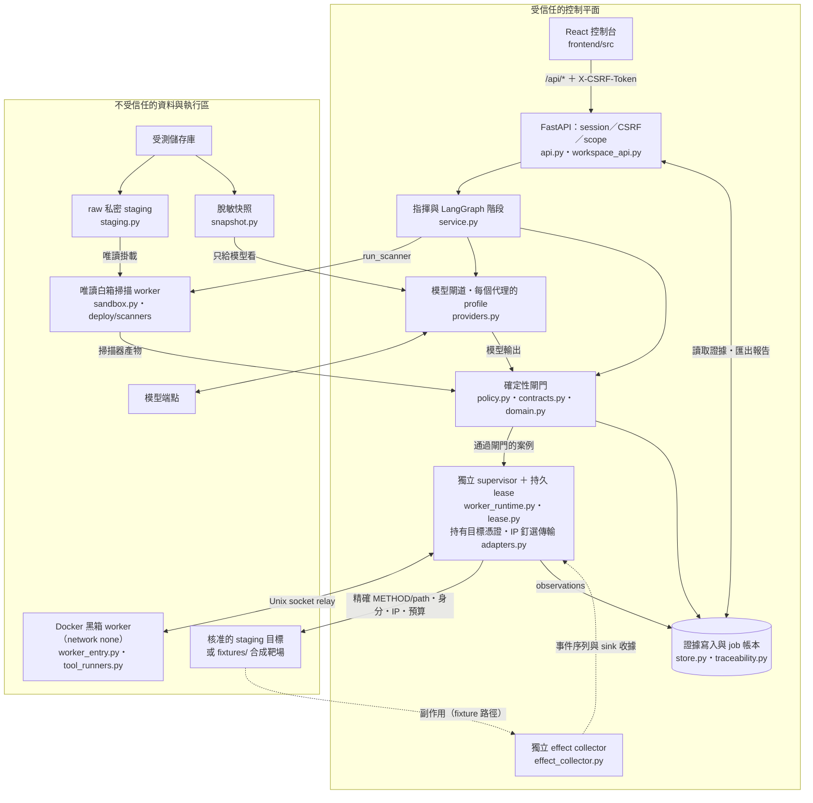
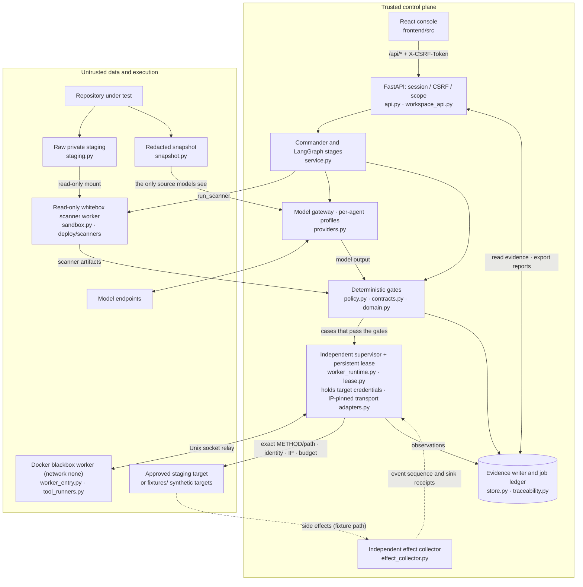

# 架構與方法論 — 0.2.1

## 控制平面與資料平面

### 模組對照

上圖每個節點對應 `backend/vibe_audit/`（或註明目錄）中的程式。兩個區塊就是下文的信任邊界：不受信任區的內容只能以資料形式經過閘門或 supervisor 進入控制平面。README 的「系統架構與流程」以階段為主軸畫出同一個系統。

| 節點 | 實作位置 |
|---|---|
| React 控制台 | `frontend/src`（建置到 `frontend/dist`，由 FastAPI 提供） |
| FastAPI：session／CSRF／scope | `api.py`、`workspace_api.py` |
| 指揮與 LangGraph 階段 | `service.py`（`STAGES`，每個階段一個圖節點） |
| 模型閘道・每個代理的 profile | `providers.py`（LiteLLM，無隱性 fallback；操作者設定的備援在 `service.py`） |
| 確定性閘門 | `policy.py`（manifest、whitebox、threat、case 閘門與 `authorize`）、`contracts.py`、`domain.py` |
| 獨立 supervisor ＋ 持久 lease | `worker_runtime.py`、`lease.py`；IP 釘選傳輸與 oracle 在 `adapters.py` |
| 獨立 effect collector | `effect_collector.py`，經 `fixture_protocol.py` 使用 |
| 證據寫入與 job 帳本 | `store.py`、`traceability.py`；報告匯出在 `service.py` |
| raw 私密 staging／脫敏快照 | `staging.py`（只給掃描器）、`snapshot.py`（只給模型） |
| 唯讀白箱掃描 worker | `sandbox.py`、`worker_runtime.py` 的 `run_scanner`、`deploy/scanners/` |
| Docker 黑箱 worker | `worker_entry.py`、`tool_runners.py`、`deploy/worker/` |
| 核准的 staging 目標 | 操作者提供；合成目標在 `fixtures/` |

受信任的控制平面包含操作者設定、模型閘道、supervisor、資料庫與證據寫入器。儲存庫、模型、目標、掃描器產物與報告文字皆屬不受信任的資料。JSON schema 驗證並不保證語意正確。broker 是強制執行點；模型 prompt 不是安全邊界。

API 只監聽 127.0.0.1。瀏覽器透過將啟動權杖——以啟動 URL 的 `#token=…` 片段形式呈現，或以 `VIBEAUDIT_SESSION_TOKEN` 固定——放入 `X-VibeAudit-Token` 傳送到 `/api/session` 來取得 session。之後它會持有 8 小時的 HttpOnly、SameSite=Strict cookie，而其餘所有 `/api` 請求（含讀取）也必須附帶 `X-CSRF-Token`。Cookie 不會依連接埠隔離，因此操作者在同一瀏覽器中開啟的 staging 服務也會收到該 cookie；CSRF token 只存在於工作臺分頁的 port-scoped sessionStorage 中，且 `/api/session` 絕不會把 token 回傳給只出示 cookie 的呼叫方。事件流與報告匯出是透過該標頭取得，而不是透過 EventSource 或普通連結。每個請求都必須帶有允許的 Host，若有送出 Origin 則必須是允許的 Origin。

## 依序執行的方法論

1. 凍結原始碼 staging、去識別化（redacted）情境、部署宣告、範圍、預算、profile 與資源版本。記錄省略項目。
2. 探測確切的模型端點。三名獨立 reviewer 各自收到相同的核心問題與原始碼情境。靜態掃描器可並行執行；初始 reviewer 看不到掃描器的結論。
3. 封存所有審查、保留聯集、保存個別主張、檢視確切的原始碼參照，並執行至多一輪 challenger。表決無法確立或駁回任何發現。
4. 建立資產、角色、信任邊界、資料流、威脅與安全需求。由模型衍生的需求保留「衍生」的來源標記。既有控制措施需要證據；未知項目保持可見。
5. 驗證威脅完整性與標準 ID。只編譯可追溯、有範圍限制的 case，並附上 positive control、明確的 oracle、允許的身分與 cleanup。模型設計的 case 只能使用操作者標記 model_selectable 的測試身分，header 值只能取固定詞彙中的單一值、不得列多項或帶 q 參數，且只能用操作者在 allowed_requests[].model_headers 為該 method 與 path 列出的值（預設沒有），header 名稱只有一種拼法、順序固定，因此無法挑選高權限帳號，帶到目標的資訊也只剩少量的選擇空間。cleanup 一律由引擎產生，不採用模型提供的內容。live run 中，模型設計的 case 要等操作者核准這組封存案例（綁定 case 雜湊的收據）後才開始黑箱執行；模型撰寫的本文只送往操作者標 model_body 的允許請求。
6. 透過不含原始碼的 worker 對外執行。每個請求都檢查 capability、lease、run/case 綁定、method/path、身分、IP 與預算。部署標頭不符時停止該分支。目標 IP 一律不能是雲端 metadata、link-local、unspecified 或 multicast 位址；預檢會拒絕指向本控制台或其資料庫的目標、憑證同時是模型金鑰的測試身分，以及 VIBEAUDIT_TARGET_CREDENTIAL_ORIGINS 沒有把憑證綁定到目標 origin 的測試身分（supervisor 送出前再核對一次）。http_case 依 supervisor 固定的順序，先送 positive control 再送案例本身各一次；黑箱 worker 只拿到送出與判定案例所需的欄位。
7. 評估實際的 observations。區分 pass/fail、inconclusive、blocked、execution_error 與 outcome_unknown。保留證據與反證；只匯出 run 所擁有且經驗證的 artifact。
8. 修復會建立一個新的連結 run，並附帶新的原始碼／部署識別。未知的副作用需要 reconciliation/reset，而不是重播。

標準用於分類威脅與需求；它們不會自動產生合規。內建的登錄檔包含 ASVS 5.0.0、WSTG 4.2、LLM 2026 與 Agentic 2026 的標準條目，附有來源釘選與品質備註。WSTG 重複的來源識別碼會在同一個標準條目中保留兩個子項目。

## 隔離與復原

Linux Docker worker 的 whitebox 使用非 root 的 UID 65532，blackbox 使用 UID 65533，並搭配移除的 capabilities、唯讀檔案系統、資源／輸出上限與 network none。Docker daemon 沒有套用 seccomp profile 時，runtime 拒絕使用，並記錄 daemon 啟用了哪些安全選項（AppArmor、user namespace、rootless）；kernel 漏洞仍可能逃出容器。只有 whitebox 會收到不可變的原始碼 staging 掛載。工具輸出寫入容器內有大小上限的 tmpfs，而非主機目錄。私密的 staging 副本（為掃描器保留儲存庫的機密檔案）會在 whitebox 階段完成時以及每次嘗試結束、blocked、failed 或 cancelled 時刪除；啟動時，磁碟上留下的任何副本都會被移除。恢復執行的掃描會重新 stage 原始碼，且必須與凍結的 intake 完全一致，否則 run 會停止。intake 略過的目錄（建置輸出、相依套件、.git、連結）會記錄為省略項目，因為掃描器和模型都看不到它們。每個 worker 在主機上的工作目錄會在確認清理後刪除。兩種 worker 都不會取得 Docker socket 或目標憑證。具特權的操作者分別供應映像與離線資料；掃描絕不會拉取映像或安裝相依套件。

獨立的 Python supervisor 使用 Unix socket relay，並持有目標憑證、IP 釘選的傳輸層與 dispatch 帳本。它能在 controller 失聯後存活足夠久的時間，以撤銷通訊並終止 worker。lease 到期、取消或 controller EOF 會在 process／container 清理之前先撤銷 socket。它不宣稱能復原已經完成的遠端副作用。

PostgreSQL 儲存 job 與 lease 記錄以及 LangGraph checkpoint。Resume 不會從這些 checkpoint 還原。當有 job 仍處於 sent 狀態、有 worker 等待清理、或某個執行為 outcome_unknown 時，resume 會被拒絕。除此之外，圖會依據已儲存的 run 記錄重新啟動：再次檢查 manifest 政策、已標記完成的 stage 會被略過、中斷的 whitebox 階段會重用輸入雜湊仍與原始碼摘要相符的已封存審查，而 blackbox 會在派發前先對已儲存的 case 重新執行 case 閘門，且只派發尚無執行紀錄的 case 重複項。Job 在 I/O 之前先標記為 sent；彙總結果與已完成的 job 以 atomic 方式一併提交。當機可能留下無害的孤兒 artifact，但無法把不確定的 dispatch 提升為新的隱式嘗試：在重新啟動時，或當某次嘗試在記錄結果前停止時，每個仍標記為 sent 的 job 都會變成一個帶有 gap 的 outcome_unknown 執行，因此匯出會顯示它，而 resume 會拒絕該 run。supervisor 區分三種情況：從未送出的請求（連線或位址失敗）沒有任何效果；答案無法回傳的唯讀請求（redirect、壓縮、大小、非 UTF-8、被截斷的內容）是已知的 observation，只會結束其 case；在上述任一情況下會改變狀態的請求則保持 outcome_unknown。HEAD 回應無論其 Content-Length 為何都沒有 body。部署標頭缺失或變更會停止 run，且 resume 會拒絕它。執行與清理各自擁有固定的生命週期識別，兩者都有重播保護。SQLite 與 process_test 用於明確的合成／測試路徑，而非正式環境的隔離。

## 工具與 AI 邊界

ZAP 只執行經審查的 requestor/passive 計畫。Schemathesis 使用明確的 schema 範例。Playwright 使用其 API client。promptfoo 使用本機自訂的 provider／eval 斷言；PyRIT 使用受控制的目標。工具不會自行擴充目標或產生任意程式。它們的 artifact 僅供輔助：安全 oracle 依賴 supervisor 的 observations 與獨立的收執。

內建的 TS Web 與 Python AI 目標是合成且確定性的。AI 試驗會重置 session／fixture 五次。Collector 事件區分 proposed → denied/allowed → invoked → committed；mock sink 收執只證明合成的 sink 效果。通用目標 profile 需要操作者宣告的生命週期步驟，以及另外註冊的受信任 collector 綁定。目標回傳的文字無法註冊綁定，也無法偽造受信任的來源證明。

## 限制

沒有完整的語意呼叫圖或窮盡的原始碼閱讀、沒有經證明的模型獨立性、不能以合成基準宣稱有效性、沒有遠端 fleet／SaaS、沒有任意的瀏覽器自動化、沒有正式環境的部署／修補。透過操作者提供的標頭進行的原始碼對部署比對，只證明該標頭相等，而非與原始碼的密碼學對應。主機管理員仍然受信任；檔案雜湊不是鑑識等級的不可變性。

---
# Architecture and methodology — 0.2.1

## Control and data planes

### Module map

Each node above maps to code in `backend/vibe_audit/` (or the named directory). The two boxes are the trust boundary described below: anything from the untrusted box reaches the control plane only as data, through a gate or the supervisor. The README's "Architecture Overview" draws the same system by stage.

| Node | Implementation |
|---|---|
| React console | `frontend/src` (built into `frontend/dist`, served by FastAPI) |
| FastAPI: session / CSRF / scope | `api.py`, `workspace_api.py` |
| Commander and LangGraph stages | `service.py` (`STAGES`, one graph node per stage) |
| Model gateway · per-agent profiles | `providers.py` (LiteLLM, no implicit fallback; the operator's fallback is in `service.py`) |
| Deterministic gates | `policy.py` (manifest, whitebox, threat and case gates and `authorize`), `contracts.py`, `domain.py` |
| Independent supervisor + persistent lease | `worker_runtime.py`, `lease.py`; IP-pinned transport and oracles in `adapters.py` |
| Independent effect collector | `effect_collector.py`, used through `fixture_protocol.py` |
| Evidence writer and job ledger | `store.py`, `traceability.py`; report export in `service.py` |
| Raw private staging / redacted snapshot | `staging.py` (scanners only), `snapshot.py` (models only) |
| Read-only whitebox scanner worker | `sandbox.py`, `run_scanner` in `worker_runtime.py`, `deploy/scanners/` |
| Docker blackbox worker | `worker_entry.py`, `tool_runners.py`, `deploy/worker/` |
| Approved staging target | Supplied by the operator; synthetic targets in `fixtures/` |

The trusted control plane includes operator configuration, the model gateway, supervisor, database and evidence writer. Repository, model, target, scanner artifacts and report text are untrusted data. JSON schema validation does not establish semantic correctness. The broker is the enforcement point; model prompts are not security boundaries.

The API listens on 127.0.0.1 only. A browser gets a session by sending the startup token, printed as the `#token=…` fragment of the launch URL or fixed with `VIBEAUDIT_SESSION_TOKEN`, to `/api/session` in `X-VibeAudit-Token`. It then holds an 8-hour HttpOnly, SameSite=Strict cookie, and every other `/api` request, reads included, must also carry `X-CSRF-Token`. Cookies are not isolated by port, so a staging service the operator opens in the same browser receives the cookie; the CSRF token lives only in the workbench tab's port-scoped sessionStorage, and `/api/session` never returns it to a cookie-only caller. The event stream and report exports are fetched with that header rather than through EventSource or plain links. Every request must carry an allowed Host, and an allowed Origin when it sends one.

## Ordered methodology

1. Freeze source staging, redacted context, deployment declaration, scope, budgets, profiles and resource versions. Record omissions.
2. Probe exact model endpoints. Each of three independent reviewers receives identical core questions and source context. Static scanners can run concurrently; initial reviewers cannot see their conclusions.
3. Seal all reviews, retain the union, preserve individual claims, inspect exact source references and run at most one challenger round. Votes cannot establish or dismiss a finding.
4. Establish assets, actors, trust boundaries, dataflows, threats and security requirements. Model-derived requirements retain derived provenance. Existing controls need evidence; unknowns remain visible.
5. Validate threat completeness and canonical standard IDs. Compile only traceable, scoped cases with positive controls, explicit oracle, allowed identities and cleanup. A model-designed case may use only test identities the operator marked model_selectable, and its header values are single values from fixed vocabularies with no lists or q parameters, limited further to the values the operator lists for that method and path in allowed_requests[].model_headers (none by default), and each header name has one spelling and a fixed order, so it cannot pick a privileged account or carry snapshot text to the target beyond a few bits of choice. Its cleanup comes from the engine, never from the model. In a live run, model-designed cases wait for the operator to approve the sealed set (a receipt over the case hashes) before black-box execution starts, and a model-written body goes only to an allowed request the operator marked model_body.
6. Execute externally through a source-free worker. Every request checks capability, lease, run/case binding, method/path, identity, IP and budget. Deployment header mismatch stops the branch. Target IPs are never cloud metadata, link-local, unspecified or multicast addresses; preflight refuses a target that is this console or its database, a test identity whose credential is also a model key, and one whose credential VIBEAUDIT_TARGET_CREDENTIAL_ORIGINS does not bind to the target's origin (the supervisor checks that binding again before sending). An http_case task sends its positive controls and then its case once, in the order the supervisor fixes, and the black-box worker receives only the case fields it needs to send and judge it.
7. Evaluate actual observations. Distinguish pass/fail, inconclusive, blocked, execution_error and outcome_unknown. Preserve evidence and counter-evidence; export only run-owned verified artifacts.
8. A fix creates a new linked run with new source/deployment identification. Unknown side effects require reconciliation/reset rather than replay.

Standards classify threats and requirements; they do not create compliance automatically. The bundled registry contains ASVS 5.0.0, WSTG 4.2, LLM 2026 and Agentic 2026 canonical entries with source pins and quality notes. WSTG's duplicated source identifier retains both subitems in one canonical entry.

## Isolation and recovery

Linux Docker workers use nonroot UID 65532 for whitebox and 65533 for blackbox, dropped capabilities, read-only filesystems, resource/output limits and network none. The runtime refuses a Docker daemon that applies no seccomp profile, and records which daemon security options (AppArmor, user namespaces, rootless) were active; a kernel vulnerability can still break out of a container. Only whitebox receives the immutable source staging mount. Tool output goes to a size-bounded in-container tmpfs, not a host directory. The private staging copy (which keeps the repository's secret files for the scanners) is deleted when the whitebox stage completes and whenever an attempt ends, blocked, failed or cancelled; at startup any copy left on disk is removed. A resumed scan restages the source and must match the frozen intake exactly, or the run stops. Directories the intake skips (build output, dependencies, .git, links) are recorded as omissions, because neither scanners nor models see them. Each worker's host work directory is deleted after confirmed cleanup. Neither worker gets the Docker socket or target credentials. The privileged operator provisions images and offline data separately; scans never pull images or install dependencies.

The independent Python supervisor uses a Unix socket relay and owns target credentials, IP-pinned transport and dispatch ledger. It survives controller loss long enough to revoke communication and terminate the worker. Lease expiry, cancellation or controller EOF revoke sockets before process/container cleanup. It does not claim to undo an already completed remote side effect.

PostgreSQL stores job and lease records and the LangGraph checkpoints. Resume does not restore from those checkpoints. It is refused while a job is still sent, a worker awaits cleanup or an execution is outcome_unknown. Otherwise the graph restarts against the stored run record: manifest policy is checked again, stages already marked complete are skipped, an interrupted whitebox stage reuses sealed reviews whose input hash still matches the source digest, and blackbox re-runs the case gate on the stored cases before dispatching only case repetitions that have no execution yet. Jobs become sent before I/O; aggregate result and completed job are committed atomically. A crash may leave harmless orphan artifacts but cannot promote an uncertain dispatch into a fresh implicit attempt: on restart, or when an attempt stops before recording a result, every job still marked sent becomes an outcome_unknown execution with a gap, so exports show it and resume refuses the run. The supervisor separates three cases: a request that never left (connection or address failure) has no effect; a read-only request whose answer cannot be relayed (redirect, compression, size, non-UTF-8, a truncated body) is a known observation that ends only its case; a state-changing request in any of those situations stays outcome_unknown. A HEAD answer has no body whatever its Content-Length. A missing or changed deployment header stops the run, and resume refuses it. Execution and cleanup have separate fixed lifecycle identities, both replay-protected. SQLite and process_test are for explicitly synthetic/test paths, not production isolation.

## Tool and AI boundaries

ZAP executes only the reviewed requestor/passive plan. Schemathesis uses an explicit schema example. Playwright uses its API client. promptfoo uses local custom provider/eval assertions; PyRIT uses a controlled target. Tools do not independently expand targets or generate arbitrary programs. Their artifacts are auxiliary: security oracles rely on supervisor observations and independent receipts.

Built-in TS Web and Python AI targets are synthetic and deterministic. AI trials reset session/fixtures five times. Collector events distinguish proposed → denied/allowed → invoked → committed; a mock sink receipt proves only the synthetic sink effect. Generic target profiles require operator-declared lifecycle steps and a separately registered trusted collector binding. Text returned by the target cannot register a binding or forge trusted provenance.

## Limits

No complete semantic call graph or exhaustive source reading, no proven model independence, no effectiveness claim from synthetic benchmarks, no remote fleet/SaaS, no arbitrary browser automation, no production deployment/patching. Source-to-deployment matching via an operator-supplied header proves that header equality, not cryptographic correspondence to the source. Host administrators remain trusted; file hashes are not forensic immutability.
