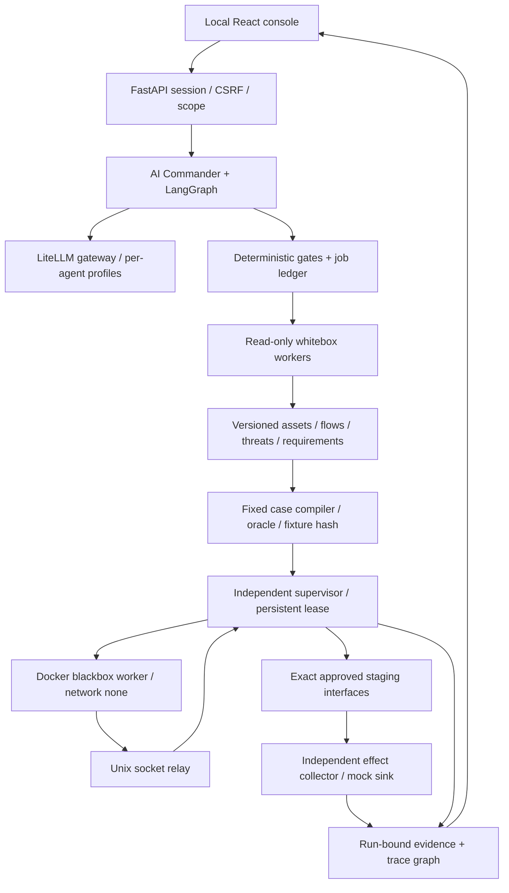

# Architecture and methodology — 0.2.0

## Control and data planes

The trusted control plane includes operator configuration, the model gateway, supervisor, database and evidence writer. Repository, model, target, scanner artifacts and report text are untrusted data. JSON schema validation does not establish semantic correctness. The broker is the enforcement point; model prompts are not security boundaries.

## Ordered methodology

1. Freeze source staging, redacted context, deployment declaration, scope, budgets, profiles and resource versions. Record omissions.
2. Probe exact model endpoints. Each of three independent reviewers receives identical core questions and source context. Static scanners can run concurrently; initial reviewers cannot see their conclusions.
3. Seal all reviews, retain the union, preserve individual claims, inspect exact source references and run at most one challenger round. Votes cannot establish or dismiss a finding.
4. Establish assets, actors, trust boundaries, dataflows, threats and security requirements. Model-derived requirements retain derived provenance. Existing controls need evidence; unknowns remain visible.
5. Validate threat completeness and canonical standard IDs. Compile only traceable, scoped cases with positive controls, explicit oracle, allowed identities and cleanup.
6. Execute externally through a source-free worker. Every request checks capability, lease, run/case binding, method/path, identity, IP and budget. Deployment header mismatch stops the branch.
7. Evaluate actual observations. Distinguish pass/fail, inconclusive, blocked, execution_error and outcome_unknown. Preserve evidence and counter-evidence; export only run-owned verified artifacts.
8. A fix creates a new linked run with new source/deployment identification. Unknown side effects require reconciliation/reset rather than replay.

Standards classify threats and requirements; they do not create compliance automatically. The bundled registry contains ASVS 5.0.0, WSTG 4.2, LLM 2026 and Agentic 2026 canonical entries with source pins and quality notes. WSTG's duplicated source identifier retains both subitems in one canonical entry.

## Isolation and recovery

Linux Docker workers use nonroot UID 65532 for whitebox and 65533 for blackbox, dropped capabilities, read-only filesystems, resource/output limits and network none. Only whitebox receives the immutable source staging mount. Tool output goes to a size-bounded in-container tmpfs, not a host directory. The private staging copy (which keeps the repository's secret files for the scanners) is deleted once the whitebox stage completes, and each worker's host work directory is deleted after confirmed cleanup. Neither worker gets the Docker socket or target credentials. The privileged operator provisions images and offline data separately; scans never pull images or install dependencies.

The independent Python supervisor uses a Unix socket relay and owns target credentials, IP-pinned transport and dispatch ledger. It survives controller loss long enough to revoke communication and terminate the worker. Lease expiry, cancellation or controller EOF revoke sockets before process/container cleanup. It does not claim to undo an already completed remote side effect.

PostgreSQL stores checkpoint, job and lease records. Jobs become sent before I/O; aggregate result and completed job are committed atomically. A crash may leave harmless orphan artifacts but cannot promote an uncertain dispatch into a fresh implicit attempt. Execution and cleanup have separate fixed lifecycle identities, both replay-protected. SQLite and process_test are for explicitly synthetic/test paths, not production isolation.

## Tool and AI boundaries

ZAP executes only the reviewed requestor/passive plan. Schemathesis uses an explicit schema example. Playwright uses its API client. promptfoo uses local custom provider/eval assertions; PyRIT uses a controlled target. Tools do not independently expand targets or generate arbitrary programs. Their artifacts are auxiliary: security oracles rely on supervisor observations and independent receipts.

Built-in TS Web and Python AI targets are synthetic and deterministic. AI trials reset session/fixtures five times. Collector events distinguish proposed → denied/allowed → invoked → committed; a mock sink receipt proves only the synthetic sink effect. Generic target profiles require operator-declared lifecycle steps and a separately registered trusted collector binding. Text returned by the target cannot register a binding or forge trusted provenance.

## Limits

No complete semantic call graph or exhaustive source reading, no proven model independence, no effectiveness claim from synthetic benchmarks, no remote fleet/SaaS, no arbitrary browser automation, no production deployment/patching. Source-to-deployment matching via an operator-supplied header proves that header equality, not cryptographic correspondence to the source. Host administrators remain trusted; file hashes are not forensic immutability.
